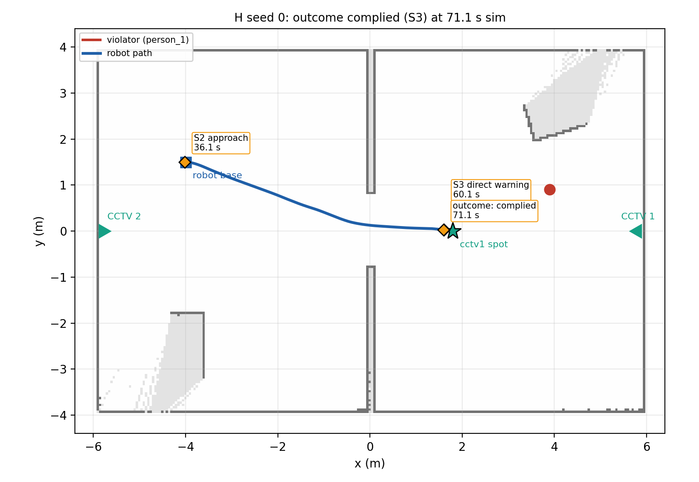
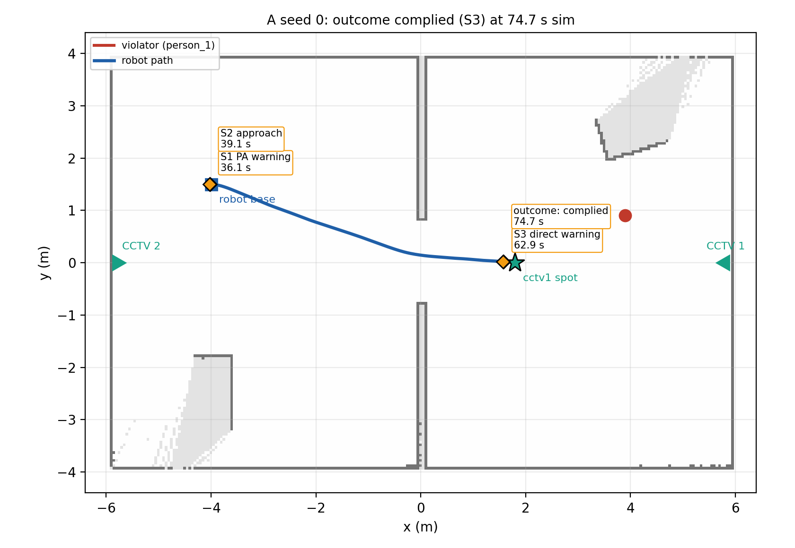
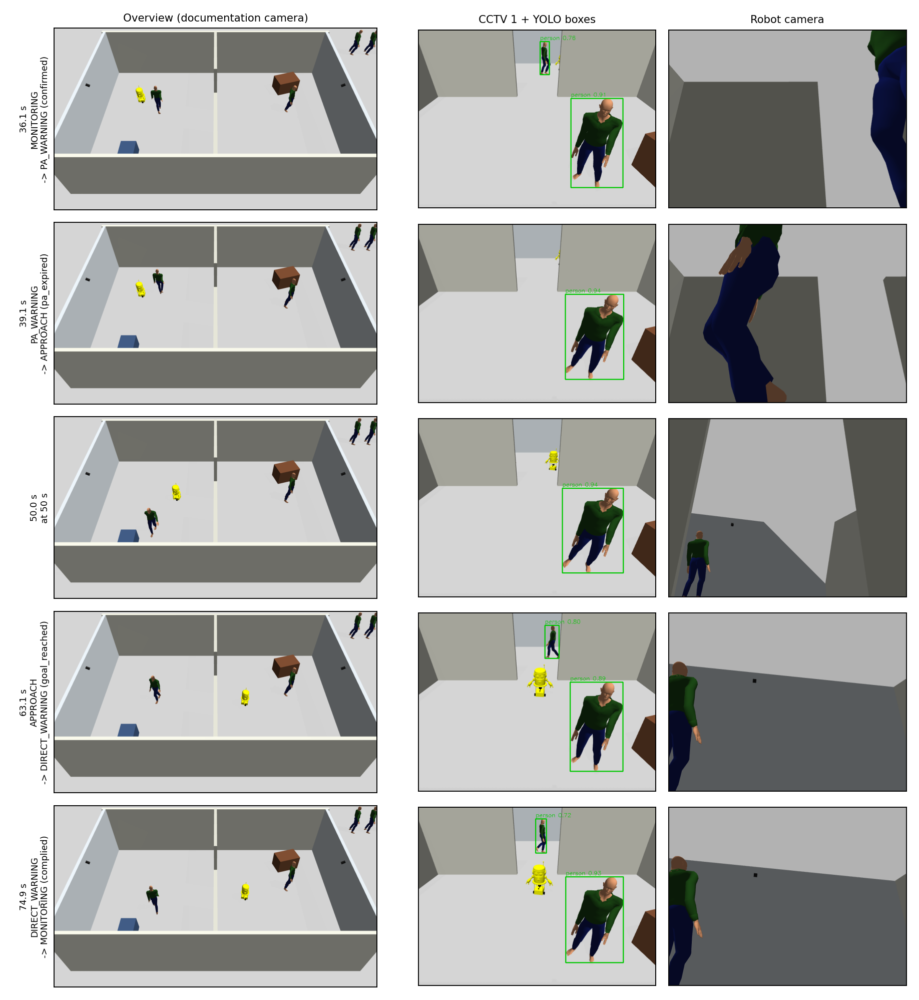

# Evidence and results

This file collects every result and piece of evidence produced while extending the
simulation evaluation of the CCTV-triggered smoking/vaping compliance robot (ROS 2 Humble,
Gazebo classic, Nav2). Each result is traced to the file that contains it and the
script that regenerates it. Nothing in this file is estimated: values come straight from
the files listed. Where something has **not** been measured, it says so.

- Repository: `Yoru_bot_publication` (a copy of `Yoru_bot_V2` at `a7a7715`, 2026-07-30)
- Detailed audit: [`docs/sim_audit.md`](../docs/sim_audit.md)
- Scripts that produce the evidence: [`evaluation/scripts/`](../evaluation/scripts/)

| Phase | Status | Evidence folder |
|---|---|---|
| 0 Audit | done | [`phase0/`](phase0/) |
| 1 Parameterised decision rule | done | [`phase1/`](phase1/) |
| 2 Logging and instrumentation | done | [`phase2/`](phase2/) |
| 3 Human response model | done | [`phase3/`](phase3/) |
| 4 Scenarios + batch runner | done: baseline batch complete, 300 / 300 valid runs (2026-10-12) | [`phase4/`](phase4/), [`run_counts.md`](../evaluation/results/run_counts.md) |
| 5 Metrics | **final** (300 runs): [E5.3](#e53-final-results-300-valid-runs) | [`evaluation/results/`](../evaluation/results/) |
| 6 Sensitivity analysis | **final** (300 runs): [E6.3](#e63-final-results-300-runs-600-events) | [`evaluation/results/sensitivity/`](../evaluation/results/sensitivity/) |
| 7 Ablation | offline ablation **final** (E6.3); node flags implemented and tested in a pending patch, **not yet applied** (no ablation runs in Gazebo) | [`phase6/`](phase6/) |
| Offline extensions | **final** (300 runs): [deployment thresholds, sustained rule, outcome vs truth](#final-results-300-runs) | [`evaluation/results/offline_extensions/`](../evaluation/results/offline_extensions/) |
| Extension A: FSM design variants | implemented, unit-tested, replay-validated on the 300 baseline bags; **not yet run in Gazebo** | [section](#extension-a-fsm-design-variants-2026-10-15), [`evaluation/results/fsm_replay/`](../evaluation/results/fsm_replay/) |
| Phase B: human model under `skip_pa_warning` | **done** (2026-11-19): `comply_s1_fallback` (default off), 14 tests, one Gazebo check run as intended. Runner support (23 tests) and gentle sessions (17 tests) done. **Phase C `hold_s1` complete (30 runs): H fixed in 10/10 (complied S1 instead of target_lost S2), C 10/10 and A 10/10 unchanged. `reset_first` 14/30 (H 10/10 complied S2, the robot still drives about 1.4 m; C 4/4 unchanged)**; the rest of `reset_first` and all of `both` not run yet | [section](#phase-b-human-model-under-skip_pa_warning-2026-11-19), [`phase_b/`](phase_b/) |
| Same laptop, new OS (after the SSD slot failure) | set up; 2 set-up problems fixed (clock steps, CPU threads); **reproduction: 45 / 45 outcomes match the baseline** (3 seeds × 15 scenarios); speed depends on background load; baseline bags not available | [section](#same-laptop-new-operating-system-2026-11-19-set-up-incidents-and-open-uncertainties), [`machine_change/`](machine_change/), [`evaluation/results/repro_wsl/`](../evaluation/results/repro_wsl/) |

**Final numbers, in one place:** [E5.3](#e53-final-results-300-valid-runs) (outcomes, timing, proximity),
[E6.3](#e63-final-results-300-runs-600-events) (sensitivity and ablation), the
[offline extensions](#final-results-300-runs), and the [final checks](#final-checks-2026-10-12) made before
release. Every number comes from a file in `evaluation/results/`, regenerated by
`bash evaluation/scripts/make_results.sh` (log: `evaluation/data/make_results_final.log`).

---

## Phase 0: Audit

### E0.1 Pre-existing incident logs (preserved)

The two incident logs from `~/compliance_robot_logs/` were copied into
[`phase0/incident_logs/`](phase0/incident_logs/) before any launch. The incident logger
deletes `*.jsonl` files older than 30 days on start-up, and `incidents.jsonl` was already
older than that. The copies are byte-identical (SHA-256):

| Original | Copy | SHA-256 |
|---|---|---|
| `incidents.jsonl` | `incidents_20260730.jsonl` | `53623753819fbe023102eb1670a9e0e102a194ea963c75405f65ded96b350d29` |
| `incidents.jsonl.before-demo-20260730_1410` | `incidents_before_demo_20260730_1410.jsonl` | `5d2baa53b080528a383bf97f6d76876b81c2252e726c17aac615e0473e86f91e` |

### E0.2 Logged confidence values: [`phase0/incident_summary.txt`](phase0/incident_summary.txt)

Regenerate: `python3 evaluation/scripts/phase0_incident_summary.py`

```
incident records: 337 total, 228 simulation (rooms room_a, sim_room_1)
minimum logged confidence (all records): 0.600
records with confidence < 0.600: 0

simulation records by (event_class, confidence, C5_support, fp_risk):
   228  ('cigarette', 0.802, 0.5, 'low')

simulation records by (stage_reached, outcome):
   164  ('S1', 'complied')
    28  ('S4', 'logged_no_compliance')
    21  ('S3', 'complied')
    12  ('S2', 'target_lost')
     1  ('S1', 'admin_override')
     1  ('S2', 'safety_stop')
     1  ('S2', 'admin_override')
```

**Result.** Every simulation incident ever logged has composite confidence 0.802. No incident
(simulation or real robot) has ever been logged below 0.600. Outcome counts mix several
configuration versions, so they are history and not comparable runs.

### E0.3 Composite recomputed with the real node: [`phase0/composite_recompute.txt`](phase0/composite_recompute.txt)

The live `EventConfirmationNode` callback was fed the exact detections `scenario_publisher_node`
injects. Regenerate:
`PYTHONPATH=src/yoru_core:$PYTHONPATH python3 evaluation/scripts/phase0_recompute_composites.py`

```
scenario      frame  D      P      T      S      C      C-0.3P  status
A smoking         1  0.780  0.800  0.200  0.500  0.642  0.402   uncertain
A smoking         4  0.780  0.800  0.800  0.500  0.762  0.522   uncertain
A smoking         5  0.780  0.800  1.000  0.500  0.802  0.562   confirmed
A-V vaping        5  0.780  0.800  1.000  0.200  0.772  0.532   confirmed
C target_loss     3  0.780  0.800  0.600  0.000  0.672  0.432   uncertain
C target_loss     4  0.780  0.800  0.800  0.000  0.712  0.472   uncertain
C target_loss     5  0.780  0.800  1.000  0.000  0.752  0.512   confirmed
```
(excerpt; the full frame-by-frame table is in the file)

**Result: dissertation figure.** The composite at confirmation is **0.802 (A), 0.772 (A-V)
and 0.752 (C)**, all above the 0.60 threshold. The figure's printed totals 0.56 / 0.53 / 0.47
equal **C − 0.3·P** (the composite with the proximity term left out) for A and A-V at
confirmation and for C at persistence count 4. That count is a non-confirming, *uncertain*
frame, because C4 needs 5. This explanation is **inferred from the arithmetic**: the figure's
source script was not found, so it cannot be checked directly.

**Result: what actually gates confirmation in the current sim.** Scenario A already reaches
C = 0.642 ≥ 0.60 on frame 1. With constant injected scores, the persistence criterion C4,
not the 0.60 threshold, decides when an event is confirmed.

### E0.4 Recorded demo outcome: [`phase0/DEMO_v2_reference.md`](phase0/DEMO_v2_reference.md)

A copy of V2's `docs/DEMO.md`. The recorded sim walkthrough ends with
`room_a / cigarette / stage S4 / logged_no_compliance`. This matches the code analysis
(audit §4 item 4): with `yoru_sim.yaml` the simulated person's compliance (6 s into S3)
cannot complete the 8 s reset before S3 ends at 12 s.

### E0.5 Configuration discrepancies (from the code; full table in audit §4)

| Rule | Research brief | `yoru_sim.yaml` (as run) |
|---|---|---|
| persistence before S1 | 5 s | 3 s |
| S1 PA | 3 s | 10 s |
| S2 timeout | 90 s | 60 s |
| S3 | 3 × 8 s, cap 30 s | 3 × 4 s, cap 16 s |
| compliance reset | 10 s | 8 s |
| target lost | 8 s | 5 s |

Decision (audit §8): the evaluation uses the brief's timings through a separate overlay;
`yoru_sim.yaml` is unchanged.

---

## Phase 1: Parameterised decision rule

Weights `w_D, w_P, w_T, w_S`, `confirm_confidence` and `uncertain_confidence` are ROS
parameters, settable from launch. `use_ros_clock` switches the FSM, scenario publisher and
goal sender to sim time. Every default equals the previous value.
Regenerate all Phase 1 evidence: `bash evaluation/scripts/phase1_evidence.sh`

### E1.1 Regression tests: [`phase1/pytest.txt`](phase1/pytest.txt), [`phase1/pytest_junit.xml`](phase1/pytest_junit.xml)

```
65 passed  (55 Phase 1 tests + 10 Phase 2 debug-replay tests; failures 0, errors 0, skipped 0)
```
The key test feeds the modified node and a **frozen copy of the original V2 decision code**
([`reference_event_confirmation_v2.py`](../src/yoru_core/test/reference_event_confirmation_v2.py))
the same 40 seeded random sequences of 150 frames. Every metadata message, every confirmed track and
the persistence counters are identical. A guard test confirms that these sequences really exercise the
confirmed, uncertain, phone-override and possible-vape branches. The frozen copy differs from
V2's source only in how it outputs results (checked by a line diff).

### E1.2 Mutation check: [`phase1/mutation_check.txt`](phase1/mutation_check.txt)

This checks that the tests can fail. The rule was deliberately broken in a temporary copy:

| Mutation | Test result |
|---|---|
| `w_P` 0.30 → 0.31 | 46 of 65 failed |
| `C ≥ τ` → `C > τ` | 1 of 65 failed |
| C7 gate removed | 1 of 65 failed |

### E1.3 Launch overrides: [`phase1/launch_override_check.txt`](phase1/launch_override_check.txt)

With no arguments, all 18 nodes receive exactly `[params_file, use_sim_time]`, as in V2. Given
overrides reach only the intended nodes, typed as float/bool.

---

## Phase 2: Logging and instrumentation

New topics (all `std_msgs/String` JSON, stamped with the node clock, which is sim time in Gazebo):

| Topic | Source | Content |
|---|---|---|
| `/compliance/fsm_state` | compliance_fsm_node | every transition: `stamp, previous_state, new_state, reason, track_id, room, stage_reached, direct_count, time_in_state`; plus a `cooldown_end` event |
| `/compliance/confirmation_debug` | event_confirmation_node | every tracked person, every frame (rejected included): unrounded `D, P, T, S, C`, `C1–C7`, `fp_risk_raw`, persistence count, decision, weights and thresholds in force, `stamp` (detection header) and `recv_stamp` |
| `/compliance/audio_event` | audio_warning_node | each S1/S3 warning: `stamp, kind, backend, track_id, room` |
| `/compliance/scenario_ground_truth` | scenario_publisher_node (latched) | `scenario_start`, `violation_onset`/`confounder_onset`, `comply_trigger`, `violation_cessation`, `target_removed` and a 1 Hz state heartbeat, each with scenario ID, seed and actor IDs/positions |
| `/compliance/incident_log_path` | incident_logger_node (latched) | absolute path of the run's `incidents.jsonl` |

FSM reasons: `confirmed, pa_expired, goal_reached, warnings_complete, direct_warning_cap,
approach_failed, approach_timeout, safe_stop, complied, target_lost, admin_override,
logged_no_compliance, safety_stop, cooldown_end`.

Bag recording: `ros2 launch yoru_bringup sim_full.launch.py bag_path:=<dir>` records 29 topics,
including `/gazebo/model_states` (the `gazebo_ros_state` plugin was added to the world), `/amcl_pose`,
`/scan`, `/tf`, `/plan`, Nav2 `navigate_to_pose` action status and feedback, and `/clock`. Per-run settings
go in an `overlay_params:=<yaml>` file applied after `yoru_sim.yaml`.

### E2.1 Headless check run, Scenario A: [`phase2/check_run/`](phase2/check_run/)

`bash evaluation/scripts/phase2_check_run.sh 170`. Settings: `yoru_sim.yaml` timings unchanged,
`use_ros_clock:=true`, audio playback off (events still published), e-mail off, incident log
inside the run folder ([`overlay.yaml`](phase2/check_run/overlay.yaml)). Full output:
[`bag_summary.txt`](phase2/check_run/bag_summary.txt). Bag: `phase2/check_run/bag/` (21 MB).

**Real-time factor: 160.0 s sim / 161.1 s wall = 0.993.**

FSM transitions (sim time, s):
```
t=  33.60      MONITORING -> PA_WARNING     reason=confirmed            track=c1_1001 room=room_a
t=  43.60      PA_WARNING -> APPROACH       reason=pa_expired
t=  50.50        APPROACH -> DIRECT_WARNING reason=goal_reached         (navigation 6.9 s)
t=  62.50  DIRECT_WARNING -> LOGGING        reason=warnings_complete
t=  64.60         LOGGING -> MONITORING     reason=logged_no_compliance
t= 124.60      MONITORING -> MONITORING     reason=cooldown_end         (64.6 + 60 s cooldown)
```
Ground truth: `violation_onset` 30.10, `comply_trigger` 50.50 (S3 entry), `violation_cessation` 56.50.
Audio events: PA at 33.60, direct warnings at 50.50 / 54.50 / 58.50 (3 × 4 s).
First confirmed frame: D=0.78, P=0.8, T=1.0, S=0.5, **C=0.802**, persistence 5.
Nav2: one goal to the camera spot (1.80, 0.00), `succeeded`.
Incident: `S4 / logged_no_compliance / confidence 0.802`.

**Result.** This is the first *measured* confirmation of audit §4 item 4. The simulated person
stopped at 56.5 s, but the 8 s reset would only have completed at 64.5 s, after S3 had already
ended at 62.5 s. So "complies during S3" ends as `logged_no_compliance` under `yoru_sim.yaml`.
This is why the evaluation uses the brief's timings (3 × 8 s S3, 10 s reset).

Negative control (one run only, not a rate): the room-B walking actor produced 1,595
debug records on `confirm_cctv2`, all `rejected`, with no escalation.

### E2.2 Offline replay of recorded decisions: [`phase2/replay_check.txt`](phase2/replay_check.txt)

`PYTHONPATH=src/yoru_core:$PYTHONPATH python3 evaluation/scripts/phase2_replay_check.py evidence/phase2/check_run/bag`
```
debug records replayed: 4238
exact matches (C bit-identical and same decision): 4238
mismatches: 0
header stamp -> node receive lag (s): median 0.198, min 0.000, max 3.200
```
**Result.** Every logged decision is reproduced exactly from its logged inputs, which is the
basis for the Phase 6 offline sensitivity analysis. The detection header stamp can lag
processing by up to 3.2 s (augment mode reuses the last YOLO header), so **time-based
metrics must use `recv_stamp`**, not `stamp`.

### E2.3 Behaviour unchanged

- No-argument launch: identical parameter lists for all 18 nodes (E1.3, regenerated after Phase 2).
- Regression and replay tests: 65/65 pass (E1.1).
- All instrumentation is additive (new publishers, plus a world plugin that only adds topics and services).
  The one structural change (all nodes are now created inside one `OpaqueFunction`) was checked to
  produce the same nodes, names, conditions and order as V2.

---

## Phase 3: Simulated human response model

Goal: make the simulated person behave, look and *physically exist* like a person, so that
detection, navigation and safety are exercised realistically.

### What was built

| Part | File | What it does |
|---|---|---|
| ROS-driven human actor (Gazebo plugin) | [`src/yoru_sim_plugins/src/yoru_actor_plugin.cpp`](../src/yoru_sim_plugins/src/yoru_actor_plugin.cpp) | Animated actor (walking/standing) moved from ROS (`/<actor>/cmd_pose`). Every update it moves a collision cylinder with the person, so the **lidar, costmaps and e-stop see people**. Scripted actors can do neither. |
| Evaluation world | [`src/yoru_bringup/worlds/eval_two_room.world`](../src/yoru_bringup/worlds/eval_two_room.world), generated by [`make_eval_world.py`](../evaluation/scripts/make_eval_world.py) | Demo world plus 3 people and 1 intruder (plugin-driven, with bodies). The demo world is unchanged. |
| Human actor node | [`human_actor_node.py`](../src/yoru_core/yoru_core/human_actor_node.py) | Seeded layout (start positions, which person is the violator), step-back after stopping, walking out of view (target loss), wandering bystanders, intruder crossing the robot's path |
| Detection model, `mode: world` | [`scenario_publisher_node.py`](../src/yoru_core/yoru_core/scenario_publisher_node.py) | Persons come **only from real YOLO** on the Gazebo CCTV image. Device/support detections are attached to the YOLO box of the violator, found by camera projection and IoU. One frame per YOLO frame. Compliance after a heard warning (`comply_stage` none/S1/S3_first/S3_last, `comply_delay_s`). Seeded noise. Confounders: phone, pen, straw, brief device, C7 conflict, walking. |
| Shared pure model | [`scenario_model.py`](../src/yoru_core/yoru_core/scenario_model.py) | Camera projection, seeded layout, seeded noise (separate random streams) |

Existing modes (`auto/augment/synthetic/off`) and the demo world are unchanged.
`human_actor_node` only starts with `use_actors:=true`.

### E3.1 Realistic person rendering: [`phase3/actor_render_*.png`](phase3/)

The first approach (a static mesh) rendered the skeleton's bind pose, a T-pose with the legs
below the floor. It was rejected in favour of the plugin. The three renders show the
plugin-driven actor standing (facing the camera), walking, and standing at the commanded
position (2.21, −1.18), which it reached within 0.02 m.

### E3.2 Camera projection vs YOLO: [`phase3/projection_check.txt`](phase3/projection_check.txt)

| Actor position | YOLOv8n person box | Projected box |
|---|---|---|
| (3.00, 0.30) | [358, 243, 78, 225], conf 0.90 | [360, 216, 65, 201] |
| (2.21, −1.18) | [191, 187, 67, 171], conf 0.89 | [191, 177, 54, 175] |

Horizontal centres agree within 2 px. This is how the violator is identified among several
YOLO persons; it is also encoded as a regression test.

### E3.3 Start positions

Six seeded start positions (x, y in m): (3.0, 0.3), (3.4, −1.2), (2.6, 1.4), (3.9, 0.9), (2.3, −1.5),
(3.9, −0.4). Each is fully inside the cctv1 image (≥ 20 px margin), ≥ 1.2 m from the camera spot
the robot drives to, and clear of the furniture. Two of them overlap in the image (realistic
partial occlusion), which is why matching uses IoU and not just horizontal position.

### E3.4 Unit tests: [`phase3/pytest.txt`](phase3/pytest.txt)

**81 passed** (65 earlier + 16 Phase 3). The Phase 3 tests cover:
- projection against the measured YOLO boxes;
- every start position visible and safe; exit and parking spots out of view;
- layout seeded, exactly one violator, every actor can be the violator;
- zero noise is an exact identity; seeded noise reproducible, with dropout 0.2 → measured 0.18–0.22 and σ 0.05 → measured within ±0.005;
- each `comply_stage` reacts to exactly the right warning; confounders never "comply";
- the brief device lasts 0.3 s (< 5 YOLO frames);
- the injected classes per scenario, with the C7-conflict cigarette below 0.75;
- default construction creates no world-mode state.

### E3.5 Gazebo check runs: [`phase3/runs/`](phase3/runs/) (overlays in [`phase3/overlays/`](phase3/overlays/))

All runs: evaluation world, sim time, `yoru_sim.yaml` timings, one seed each. They demonstrate the
mechanisms; they are **not** statistical results. Regenerate any run with
`bash evaluation/scripts/check_run.sh <out_dir> <overlay> <seconds>`.

| Run | Set-up | What happened (from `bag_summary.txt`) |
|---|---|---|
| **P3_A** | smoking, comply 3 s after the 1st direct warning, step back 1 m, noise σ 0.05 / dropout 10 % / bbox 3 px, seed 1 | Violator placed at (3.4, −1.2). Confirmed with D = 0.797 (noisy). S1 34.1 → S2 44.1 → S3 51.1 → **complied** 61.5. Cessation 54.1; person stepped from (3.40, −1.20) to (4.22, −1.73), 0.98 m directly away from the robot. 12 of 96 matched frames dropped. Incident `S3 / complied`. RTF 0.846. |
| **P3_JK** | 3 people (seed 2 → violator `person_2`), never complies, intruder 2 s into S2 | Only the violator was confirmed; no bystander escalated (violator matched to a YOLO box in 514 of 633 frames). Intruder crossed 2 m sideways into the path 1 m ahead of the robot (at 48.4 s); lidar min 0.303 m; **SAFE_STOP** at 48.9 s (0.4 s debounce), robot stopped at (0.94, 0.00), 0.40 m centre to centre from the person. |
| **P3_C** | cigarette, violator walks out of view 2 s into S2 | Departure 46.1 s; out of view by about 48 s. The robot reached the camera spot (51.3 s) before the 5 s target-lost window expired, so the FSM ended **`complied`** in S3. See finding 1. |
| **P3_E** | brief device (0.3 s every 6 s) + a wandering bystander | **No escalation.** 27 uncertain frames, 0 confirmed; persistence count never above 2 ([`c7_and_brief_cause.txt`](phase3/c7_and_brief_cause.txt)). 12 of those frames had C ≥ 0.60: **C4 alone prevented a false intervention.** |
| **P3_C7** | cigarette at D = 0.70 + phone at the mouth | **No escalation.** 343 frames passed C ≥ 0.6, C1, C2 and C4, and were blocked only by `fp_risk = high`: **C7 alone decided.** |
| **legacy_regression** | original demo world and mode, as Phase 2 | Same transition sequence and outcome as E2.1 (`logged_no_compliance`, C = 0.802); goal reached at 50.7 s vs 50.5 s. Existing behaviour unchanged. |

Offline replay of every Phase 3 bag ([`phase3/replay_check.txt`](phase3/replay_check.txt)): 10,953 records,
**0 mismatches**.

`P3_JK_first_attempt/` (summary only) is kept as a record of a plugin bug found and fixed. A
teleport followed immediately by a walk command lost the teleport, so the intruder walked from its
parking spot through the walls, arrived late and pushed the robot. The fix keeps a pending
teleport separately; the rerun is P3_JK.

### Findings that affect Phase 4

1. **Target loss cannot occur in S2 in the current layout.** The robot's base is at the doorway
   (0, 0) and the camera spot is 1.8 m away, so S2 lasts about 7 s. That is shorter than the 5 s
   (sim) target-lost window plus the time a departing person stays visible, and shorter than the
   brief's 8 s window. A person who leaves is then classified `complied`, because the FSM cannot
   tell absence from compliance. Proposed for Phase 4 (realism): a base farther away (room B), so
   S2 has a realistic length and navigation metrics (time, path length, replans) mean something.
2. **The real-time factor drops to 0.85–0.93 with four actors.** All decision timing now uses sim
   time, so this affects wall-clock duration, not results.
3. **Persistence is counted in real YOLO frames (about 4.6 Hz)** in world mode. Five frames are therefore
   about 1.1 s, not 0.5 s as in the legacy 10 Hz injection. This is more realistic, and must be stated in the paper.
4. **Known realism limits:** the intruder appears (teleports) 2 m beside the path before walking
   in; actors walk in straight lines without avoiding obstacles; the device itself is still an
   injected detection (no trained cigarette model runs on the Gazebo image).

---

## Phase 4: Scenario configs and batch runner

How to reproduce everything: [`evaluation/README.md`](../evaluation/README.md).

### Evaluation set-up (applies to every Phase 4+ run)

| Item | Value | Why |
|---|---|---|
| FSM timings | research brief: S0 5 s, S1 3 s, S2 ≤ 90 s, S3 3 × 8 s (cap 30 s), S4 2 s, reset 10 s, target lost 8 s, SAFE_STOP 0.35 m / 0.4 s, cooldown 60 s ([`eval_base.yaml`](../evaluation/config/eval_base.yaml)) | audit §8 Q2: gives scenarios their intended meaning (E2.1) |
| Robot base | room B (−4.0, 1.5, 0); spawn **and** AMCL initial pose ([`eval_launch.yaml`](../evaluation/config/eval_launch.yaml)) | Phase 3 finding 1: a realistic approach of about 24 s instead of about 7 s. New launch args `spawn_x/y/yaw` default to 0 (doorway, as before); checked identical by value and type. |
| Perception | real YOLOv8n persons; injected device/support with σ = 0.05, dropout 5 %, bbox jitter 3 px | realistic detector noise |
| Clock | sim time for all decision timing | ground rule 5 |
| Admin override (L) | `human_actor_node` publishes `/compliance/autonomy_paused = true`, exactly as the dashboard Pause button does | new param `admin_override_state/delay`, default off |

Scenarios ([`evaluation/scenarios/`](../evaluation/scenarios/)): A, A-V, B, **B-C7** (C7 variant,
audit §8 Q4), C, D, E, **F-pen, F-straw**, G, H, I, J, K, L. Each file records the ground truth
(violation or not) and the **expected outcome predicted from the FSM logic before any run**.
Predictions are compared with results; they are never used to tune a run.

### Batch runner: [`evaluation/scripts/run_batch.py`](../evaluation/scripts/run_batch.py)

Headless gzserver; scenarios × seeds (default 20); optional `--w-d/--w-p/--w-t/--w-s/--threshold`
(the uncertain band becomes [τ − 0.20, τ)); one bag per run under
`evaluation/data/runs/<tag>/<scenario>/<seed>/`; the run stops 10 s (sim) after the FSM outcome or at
`max_sim_s`; wall timeout; each run in its own process group and DDS domain; SIGINT → SIGTERM →
SIGKILL with a check that nothing survived; manifest CSV (scenario, seed, weights, status, outcome,
stage, outcome time, expected outcome, ground truth, wall start/end, RTF, attempts, bag check,
processes that died, code SHA-256).

**Problems the pilot exposed, and how they were fixed** (the invalid data is kept, renamed, under `evaluation/data/`):

1. `pilot_attempt1_INVALID_overlay_not_applied`: the run folder was a relative path and the launch runs
   inside it, so `overlay_params` pointed at a non-existent file, **which ROS 2 launch silently
   ignores**. The nodes ran on `yoru_sim.yaml` defaults (PA 10 s, `mode=auto`). Fixed with absolute
   paths, **plus a guard**: 20 s after start-up the runner checks that the nodes report the overlay's
   values (`mode=world`, the run's seed); otherwise the run is marked `config_not_applied` and retried.
   The same attempt also found the monitor's `/clock` subscription was RELIABLE while Gazebo publishes
   BEST_EFFORT (fixed).
2. `pilot_attempt2_stage_label_bug`: the outcome event reported `stage_reached = S0`, because the FSM
   resets the stage just before publishing. The Phase 2 instrumentation now reports the stage actually
   reached (new test `test_outcome_event_reports_the_stage_reached`; FSM behaviour unchanged; 82 tests pass).

### E4.1 Pilot: Scenario A × seeds 0–2: [`phase4/`](phase4/)

[`pilot_manifest.csv`](phase4/pilot_manifest.csv), per-seed `pilot_A_seed*_bag_summary.txt`,
`run_info.json`, and the merged overlay of seed 0. Bags in `evaluation/data/pilot/` (about 13 MB each).

| | seed 0 | seed 1 | seed 2 |
|---|---|---|---|
| status / outcome | ok / complied (S3) | ok / complied (S3) | ok / complied (S3) |
| violator start (m) | (3.9, 0.9) | (3.4, −1.2) | (3.0, 0.3) |
| violation onset → first confirmation (s) | 30.2 → 30.9 | 30.2 → 30.9 | 30.2 → 30.9 |
| first confirmed D (noisy) / C | 0.761 / 0.794 | 0.797 / 0.809 | 0.783 / 0.803 |
| S1 / S2 / S3 entry (s) | 36.1 / 39.1 / 62.9 | 36.1 / 39.1 / 63.5 | 36.1 / 39.1 / 63.1 |
| S2 duration (s) | 23.8 | 24.4 | 24.0 |
| cessation → `complied` (s) | 64.9 → 74.8 | 65.5 → 75.4 | 65.1 → 74.8 |
| dropped / matched frames | 8 / 174 | 10 / 177 | 6 / 174 |
| min robot–violator distance (m) | 2.48 | 2.20 | 1.43 |
| wall s / RTF | 96.1 / 0.893 | 96.1 / 0.894 | 95.1 / 0.898 |

Checks against the configuration: S1 starts 5.2 s after the first confirmation (5 s rule + 0.1 s tick
+ frame timing); S1 lasts exactly 3.0 s; `complied` follows cessation by 9.7–9.9 s (10 s reset, measured
from the last confirmed frame); dropout 3–6 % against the 5 % setting. These are 3 seeds: they verify
the pipeline, not the statistics.

### E4.2 Smoke test: every scenario, seed 100: [`phase4/smoke_table.md`](phase4/smoke_table.md)

Seed 100 is outside the 0–19 used for the real runs. All 15 runs `ok`, no process died, all cleaned
up; total wall time 1,550 s (about 103 s per run, so **the full 15 × 20 batch is about 9 h** and about 4 GB of bags).

| Scenario | Status | Outcome | Stage | Expected | Match | Wall s | RTF |
|---|---|---|---|---|---|---|---|
| A | ok | complied | S3 | complied | yes | 95.1 | 0.894 |
| A-V | ok | complied | S3 | complied | yes | 96.1 | 0.899 |
| B | ok | none | - | none | yes | 133.2 | 0.906 |
| B-C7 | ok | logged_no_compliance | S4 | none | **no** | 113.1 | 0.899 |
| C | ok | target_lost | S2 | target_lost | yes | 71.1 | 0.879 |
| D | ok | none | - | none | yes | 133.2 | 0.906 |
| E | ok | none | - | none | yes | 132.2 | 0.911 |
| F-pen | ok | none | - | none | yes | 133.2 | 0.907 |
| F-straw | ok | none | - | none | yes | 132.2 | 0.909 |
| G | ok | logged_no_compliance | S4 | logged_no_compliance | yes | 112.1 | 0.892 |
| H | ok | target_lost | S2 | target_lost | yes | 63.1 | 0.878 |
| I | ok | complied | S3 | complied | yes | 95.1 | 0.896 |
| J | ok | complied | S3 | complied | yes | 95.1 | 0.896 |
| K | ok | safety_stop | S2 | safety_stop | yes | 83.1 | 0.893 |
| L | ok | admin_override | S2 | admin_override | yes | 62.1 | 0.878 |

Mechanism details from the bags: **K**: intruder in the path at 59.9 s, lidar min 0.322 m, SAFE_STOP
at 60.5 s, robot–person 0.42 m (no contact). **L**: pause published 5 s into S2, FSM `admin_override`
0.1 s later. **C**: person left at 42.6 s; `target_lost` at 52.3 s (now possible thanks to the room-B
base). **H**: stopped 1 s after the PA; S1 (3 s) ended before the 10 s reset, and S2 reported
`target_lost` after 8 s, as predicted from the FSM logic. **I**: stepped back 1 m.

**Unexpected result: B-C7** ([`phase4/smoke_B-C7_cause.txt`](phase4/smoke_B-C7_cause.txt)). The cigarette
is injected at D = 0.70, below the 0.75 override. With σ = 0.05 detector noise, D exceeded 0.75 on
some frames, so the override switched C7 off. 55 frames were confirmed (D 0.750–0.836), scattered
over 34–101 s, and that was enough to escalate to S4. The FSM's 5 s rule needs a first confirmation
≥ 5 s ago and one in the last 10 s, **not continuous confirmation**. In the noise-free Phase 3 run C7
blocked everything. **Interpretation:** the single-frame override threshold makes the C7 guard
fragile under detector noise. This is a property of the system, kept as a result, and one the Phase 6
analysis can quantify.

---

## Phase 5: Metrics extraction and summary statistics

### Tools

| Script | Output |
|---|---|
| [`extract_metrics.py`](../evaluation/scripts/extract_metrics.py) (uses `rosbags` 0.11.5) | `evaluation/data/metrics.csv`, one row per run |
| [`summarise.py`](../evaluation/scripts/summarise.py) | `evaluation/results/`: `continuous.csv`, `rates.csv`, `outcomes.csv`, `tables.md`, `tables.tex` |

### Metric definitions as implemented (all times in sim seconds)

| Symbol / metric | Source |
|---|---|
| t_v | ground truth `violation_onset` |
| t_conf | first `confirmed` record on `/compliance/confirmation_debug`, by `recv_stamp` (E2.2: the header stamp can lag by up to 3.2 s) |
| t_w1 | FSM transition → PA_WARNING (S1 entry) |
| t_g / t_a | Nav2 action status: acceptance stamp of the first goal after S2 entry / first SUCCEEDED of that goal |
| t_c | first frame of the violator's camera after its last confirmed frame before t_r. If the person has left the view and no frame exists, it is the last confirmed frame + median frame interval (`t_c_source`). |
| t_r | FSM transition → MONITORING with an outcome |
| p_R, p_H | Gazebo ground truth (`/gazebo/model_states`), violator from the layout |
| confirmation_latency, detection_to_intervention, navigation_time | t_conf − t_v, t_w1 − t_conf, t_a − t_g |
| path_length | sum of ground-truth robot displacements during S2 |
| replans | two columns: `nav_recoveries` (Nav2 feedback `number_of_recoveries`) and `plan_updates` (`/plan` messages during S2; the replanning behaviour tree replans about once a second) |
| compliance_latency, violation_duration | t_c − t_w1, t_c − t_conf (`complied` runs only) |
| termination_latency | t_r − t_c, flagged when it differs by more than 0.5 s from the run's own reset (10 s) or target-lost (8 s) window, read from the run's `overlay.yaml` |
| stop_back_distance, min_distance, step_back_distance | ‖p_R(t_a) − p_H(t_a)‖; min ‖p_R − p_H‖ over S2–S3 (plus the minimum to *any* person); ‖p_H(t_c + 3 s) − p_H(t_last_warning)‖ |
| escalation_depth, warnings_delivered | highest stage 0–4; S1 + S3 audio events between t_w1 and t_r |
| outcome | complied / target_lost / logged / safety_stop / admin_override / none (`safety_stop` added: Scenario K's outcome) |
| false_intervention | violation-free run reached ≥ S1 (NaN for violation runs) |
| missed | violation run never confirmed (NaN for violation-free runs) |
| safety | `safe_stop_count`; `min_scan_range` over S2–S3 (beams > 0.2 m, as the e-stop filters the robot's own frame); `target_loss_count` |
| quality control | `cctv1_frame_hz`: effective YOLO frame rate in sim time per run (CPU load would show here); `rtf` |

Messages without a header stamp (model states, Nav2 action status, `/plan`) are placed in sim time
through the recorded `/clock` (±0.1 s). A metric that does not apply is empty, never estimated.

### E5.1 Tool validation on the pilot + smoke runs: [`phase5/tool_validation/`](phase5/tool_validation/)

These 18 runs exist only to check the tools. **They are not results** (one seed per scenario).
Extracted values were checked against independent sources:

| Check | Result |
|---|---|
| t_w1 / t_r vs `bag_summary.py` (rosbag2_py) | identical (e.g. A seed 0: 36.1 / 74.8 s) |
| t_a (from Nav2 status + clock mapping) vs FSM `goal_reached` stamp | within 0.1 s in all 8 runs where both exist |
| termination latency | 9.7–9.8 s for `complied` (window 10 s); 7.8–7.9 s for `target_lost` (window 8 s); none flagged |
| t_c vs scripted cessation | lag 0.0–0.2 s (one YOLO frame) |
| step_back_distance | I: 0.98 m (1 m scripted); A/J: 0.00 m |
| K min distance to any person | 0.419 m (bag summary 0.42 m) |
| expected-outcome match | 17/18; the mismatch is B-C7 (E4.2) |

Statistics tests ([`test_statistics.txt`](phase5/tool_validation/test_statistics.txt)): **8 passed**,
including Wilson intervals against Newcombe (1998) reference values (e.g. 81/263 →
[0.2553, 0.3662]), bootstrap reproducibility and coverage, and median/IQR against NumPy. LaTeX output is
`booktabs`, checked by eye; **it was not compiled here** (no LaTeX installation).

### E5.2 Baseline batch: how the 300 runs were produced

**Infrastructure failure found during the batch: Nav2 bring-up hang.** After 21 clean runs, A-V seeds
1 and 2 ended `logged` after the 90 s S2 timeout with the robot never moving. Their logs show the Nav2
localization lifecycle manager configured AMCL but **never activated it** (no map → base_link
transform), and the navigation manager hung on "Activating planner_server". The goal sender could
therefore never send a goal. This is a Nav2 start-up race (V2's history contains a commit for a similar
bring-up abort on the real robot), not behaviour of the compliance system, so such runs are invalid
observations. Evidence: `evaluation/data/runs_invalid/`.
No foreign DDS participants were found; only the run's own process group existed.

Fix (runner only, no change under `src/`): (1) at sim 28 s, before the 30 s onset, both Nav2 lifecycle
managers must have logged "Managed nodes are active", otherwise `nav2_not_ready` and retry;
(2) `--skip-existing` re-validates earlier `ok` runs with the same check, so the two affected runs
are redone; (3) a redone run's folder is **moved** to `evaluation/data/runs_invalid/<run>__<time>__<reason>`,
never deleted; (4) the manifest stays append-only and the analysis scripts use the latest row per run.
All earlier pilot, smoke and Scenario A runs pass the check. The batch was restarted at 15:32 with
the same code fingerprint (`e76b171d83faafe5`). In the first redo, A-V seed 1 hung again on attempt 1
(caught at sim 28.2 s) and completed normally on attempt 2. The number of attempts per run is in the
manifest (`attempts`), so the infrastructure failure rate can be reported.

15 scenarios × seeds 0–19 = 300 runs, started 2026-10-05 14:30, about 110 s each (expected finish
about 23:45). Log: `evaluation/data/baseline_batch.log`; manifest: `evaluation/data/manifest.csv`.
The code fingerprint is recorded **per run**: nothing under `src/` is edited while the batch runs,
and any edit would show up as a changed `code_sha256`. All 300 valid runs carry the same fingerprint.
Results: [E5.3](#e53-final-results-300-valid-runs).

**Batch history (how the 300 runs were produced):**

| When | Event | Effect on the data |
|---|---|---|
| 2026-10-05 14:30 | batch started | – |
| 2026-10-05 15:32 | restarted with the Nav2 readiness guard (above) | 1 run interrupted (redone) |
| 2026-10-05 22:19 to 2026-10-06 09:10 | **runner defect:** a Gazebo server escaped the runner's cleanup in its own session and kept Gazebo's master port, so every new Gazebo exited at once (code 255) and the robot could not spawn. 107 runs were hit: 106 failed both attempts (`startup_failed` in the manifest), and K/2 failed its first attempt before the restart interrupted its second. That is 213 attempts in all | no valid run affected; all redone. The failed attempts are kept in `runs_invalid/` and classified as a runner defect in `run_counts.md` |
| 2026-10-06 09:12 | fixed and restarted: before and after every run, any Gazebo server running this project's worlds is swept (tested on decoys: other Gazebo instances and shells are left alone); the batch now stops after 3 consecutive start-up failures | – |
| 2026-10-06 09:40 | paused on request (164 / 300 valid) | 1 run interrupted (redone) |
| 2026-10-12 14:26 | resumed | – |
| 2026-10-12 18:47 | K/1 finished `ok` with no escalation (expected: SAFE_STOP). Its violator had never been placed in the scene: the person stayed at the parking spot (8.0, 6.0), outside the building. The cause is a lost placement message in `human_actor_node` (a race; `src/` left unchanged). New post-hoc check [`check_actor_placement.py`](../evaluation/scripts/check_actor_placement.py): every person of the layout must be inside the building at the first ground-truth heartbeat after onset. The runner now applies it to every new run (`actors_not_placed`, retried). All 300 runs were checked; only K/1 failed | K/1 moved to `runs_invalid/` and redone (`ok`, SAFE_STOP at 63.5 s) |
| 2026-10-12 20:25 | batch complete: **300 / 300 valid**, one code fingerprint | – |

Environment check before resuming (2026-10-12): code fingerprint unchanged (`e76b171d83faafe5`); the
pinned Python packages are unchanged; system updates in the pause touched only LibreOffice components,
libfreetype and libsoup (no ROS 2, Gazebo, Nav2 or Python packages); the kernel moved from
6.8.0-136 to 6.8.0-138. The runs before and after the pause therefore use the same software stack for
everything the evaluation depends on.

### E5.3 Final results (300 valid runs)

Source files: [`tables.md`](../evaluation/results/tables.md) (and `tables.tex`),
[`outcomes.csv`](../evaluation/results/outcomes.csv), [`rates.csv`](../evaluation/results/rates.csv),
[`continuous.csv`](../evaluation/results/continuous.csv), per run in
[`evaluation/data/metrics.csv`](../evaluation/data/metrics.csv), figures in
[`evaluation/results/figures/`](../evaluation/results/figures/). 15 scenarios × 20 seeds, all with code
fingerprint `e76b171d83faafe5`. Wilson 95 % CIs in brackets.

**Outcomes.** 277 of 300 runs (92.3 % [88.8, 94.8]) ended exactly as predicted before any run. The 23 that did not are
all explained below.

| Scenario | GT | Predicted | Observed (20 runs) | Match |
|---|---|---|---|---|
| A, A-V, I | V | complied | complied 20 each | 20/20 each |
| B, D, E, F-pen, F-straw | N | no escalation | no escalation 20 each | 20/20 each |
| **B-C7** | V | no escalation (C7 suppresses) | **logged (S4) 20** | **0/20** [0, 16] % |
| C | V | target lost | target lost 20 | 20/20 |
| G | V | logged (S4) | logged 20 | 20/20 |
| H | V | target lost | target lost 20 | 20/20 |
| **J** | V | complied | complied 17, **no escalation 3** | **17/20** (85 % [64, 95]) |
| K | V | SAFE_STOP | SAFE_STOP 20 | 20/20 |
| L | V | admin override | admin override 20 | 20/20 |

- **False interventions: 0 / 100** violation-free runs (0 % [0, 3.7]). **Missed violations: 3 / 200**
  (1.5 % [0.5, 4.3]), all in J. Termination-latency flags: 0. SAFE_STOP only in K (20 / 20), never elsewhere.
- **B-C7 (designed miss, observed escalation).** The cigarette scores 0.70 with σ = 0.05 noise. Some frames
  rise above the 0.75 C7 override, and one confirmed frame is enough to start S1. Confirmation took longer than
  for a clean violation: median 1.80 s [IQR 1.20, 2.65], against 0.80 s.
- **J misses (3 / 20: seeds 1, 3, 14).** The violator stands partly behind a bystander. YOLO's person score
  for the violator's track stays at median 0.46 (maximum 0.56; 1,819 frames over the 3 runs) and never
  reaches the 0.70 C1 gate. The track carries the device in 484–750 frames, but C1 never holds, so the C4
  persistence counter stays at 0 and no frame is confirmed. In a confirmed J run (seed 0) the same score is
  0.93. This is a perception limit (occlusion), not a rule defect. Recomputed from the bags (`person_score` in
  the debug records).
- **Outcome vs truth** (`outcome_vs_truth` in `metrics.csv`): correct no intervention 100; compliance
  correctly recognised 77; continued violation correctly logged 40; departure correctly recorded as target
  lost 20 (C); **true compliance recorded as target lost 20 (H)**; interrupted by SAFE_STOP 20 (K) or by
  the admin 20 (L); missed violation 3 (J).

**Timing, navigation, proximity** (sim time; pooled over the runs where the metric applies; median [IQR],
range):

| Metric | n | Median [IQR] | Range |
|---|---|---|---|
| Confirmation latency (s), excl. B-C7 | 177 | 0.80 [0.80, 0.80] | 0.80–1.70 |
| Detection to intervention, S1 (s) | 197 | 5.10 [5.00, 5.10] | 5.00–5.10 |
| Navigation time to the camera spot (s) | 117 | 23.50 [23.41, 23.58] | 23.24–24.16 |
| Path length, full approach (m) | 117 | 5.85 [5.84, 5.86] | 5.81–5.90 |
| Nav2 recoveries | 197 | 0 [0, 0] | 0–1 |
| Compliance latency, S1 → compliance (s) | 77 | 28.90 [28.90, 29.10] | 28.10–29.50 |
| Violation duration (s) | 77 | 34.00 [34.00, 34.10] | 33.10–34.60 |
| Termination latency, 10 s reset (s) | 77 | 9.80 [9.80, 9.80] | 9.70–9.90 |
| Termination latency, 8 s target lost (s) | 40 | 7.90 [7.90, 7.90] | 7.80–8.00 |
| Robot–violator distance at arrival (m) | 117 | 2.19 [1.69, 2.35] | 1.39–2.50 |
| Step-back distance, I (m) | 20 | 0.98 [0.98, 0.98] | 0.98 |
| Minimum lidar range, S2–S3, excl. K (m) | 177 | 0.65 [0.63, 1.20] | 0.60–1.80 |
| K: minimum lidar range (m) / distance to the crossing person (m) | 20 | 0.32 [0.31, 0.33] / 0.41 [0.41, 0.43] | 0.30–0.33 / 0.37–0.43 |
| cctv1 frame rate, sim time (Hz) | 300 | 5.00 [4.95, 5.01] | 3.96–5.02 |
| Real-time factor | 300 | 0.91 [0.90, 0.93] | 0.86–0.96 |

- The robot always stops at the fixed camera spot. Its distance to the violator (1.39–2.50 m) therefore
  depends on where the person stands, and it falls in Hall's social zone (1.2–3.6 m) in all 117 arrivals.
- Warnings delivered: 3 in A, A-V, I and the 17 confirmed J runs (1 PA + 2 direct); 4 in G and B-C7
  (1 PA + 3 direct, then S4); 1 (PA only) in C, H, K and L.
- Single-person scenarios share the seeded noise and start positions per seed (common random numbers).
  Their confirmation and detection-to-intervention statistics are therefore identical across G, H, I, K and L
  (0.84 ± 0.12 s and 5.09 ± 0.03 s).

---

## Phase 6: Event-level sensitivity analysis (offline)

### Finding that shaped the analysis: the "5 s persistence" is a delay

While reproducing the FSM logic offline, the code showed that S1 does **not** require a
confirmed event to persist for 5 s. A **single** confirmed frame starts the track's timer, and S1
fires 5 s later provided that track was confirmed within the last 10 s
(audit §4 item 10). Measured: S1 followed the first confirmed frame by 5.00–5.10 s in all 18
development runs, and the B-C7 smoke run escalated on scattered noise-driven confirmations (E4.2).
**For the paper:** the only persistence check is C4 (5 frames at frame level); the event-level
decision that triggers an intervention is "≥ 1 confirmed frame".

### Tool: [`evaluation/scripts/sensitivity_offline.py`](../evaluation/scripts/sensitivity_offline.py)

- **Events:** one per (run, camera). cctv1 takes the run's ground truth; cctv2 is always negative (room B
  never has a device). Violation events use only frames between onset and the scripted cessation.
  Confirmed = ≥ 1 confirmed frame; otherwise uncertain if any uncertain frame; otherwise rejected.
- **Recomputation:** the node's own arithmetic and gates (C ≥ τ ∧ C1 ∧ C2 ∧ C4 ∧ fp_risk ≠ high;
  uncertain band [τ − 0.20, τ)). C4 depends only on C1–C3, so the logged persistence is valid for
  every weight/threshold setting.
- **Configurations:** 4 weight sets (baseline 0.40/0.30/0.20/0.10, device-emphasis 0.50/0.25/0.15/0.10,
  persistence-emphasis 0.30/0.25/0.35/0.10, balanced 0.25 each) × τ ∈ {0.50, 0.60, 0.70}, plus
  one-at-a-time ±0.05/±0.10 on each weight with the others rescaled proportionally (16): 28 in total, plus
  the 3 offline ablations (below): 31 settings.
- **Per configuration:** confirmed/uncertain/rejected events, false confirmations, misses,
  precision/recall/F1, decisions changed and stability vs baseline, exact McNemar test on correctness vs
  baseline (Holm-corrected over the 30 non-baseline configurations), median confirmation latency,
  confirmed frames; plus a τ sweep 0.40–0.90 per weight set; plus the list of configurations that
  change any event decision (the candidates for Gazebo re-runs).

### E6.1 Tool validation on the 18 development runs: [`phase6/tool_validation/`](phase6/tool_validation/)

**Not results** (one seed per scenario). Required validations:

| Validation | Result |
|---|---|
| Baseline recomputation vs every logged online value | **0 / 30,610** C mismatches, **0 / 30,610** decision mismatches (bit-exact; scalar `confirmation_rule` cross-check 0 / 2,000) |
| Event decision vs the real FSM escalating | **18 / 18** runs agree |

A bug found by validation and fixed: frames are cached as 17-significant-digit CSV, but pandas'
default parser read 0.6 back as 0.5999999999999999 (1 ulp). The guard refused the cached data; it
is now read with `float_precision='round_trip'`, and the bit-exact check passes from the cache too.

What the development data already show (to be confirmed on the full set): only **balanced@0.70**
changed any decision, missing B-C7 and C. Both have no supporting evidence (S = 0), so the balanced
composite tops out around 0.63–0.65, below 0.70. Perfect event-level classification held for
τ 0.40–0.77 (baseline), 0.40–0.76 (device-emphasis), 0.40–0.80 (persistence-emphasis) and 0.40–0.65
(balanced). **No false confirmation at any τ ≥ 0.40**, because every violation-free scenario either has no
device detection (C2 fails) or is stopped by C4. Within this scenario set, weights and threshold can
therefore only cause misses, never false alarms. This is a limit of the scenario set, to be stated in the paper.

Regenerate: `python3 evaluation/scripts/sensitivity_offline.py` (full baseline, once the batch has
finished) → `evaluation/results/sensitivity/`.

### E6.2 Preview on the first 39 real baseline runs (A × 20, A-V × 19), 2026-10-05 16:30 (superseded by E6.3)

Real noisy data, but only two scenarios, both violations: **a preview, not the result.**
Validation: 0 / 54,271 mismatches; 39 / 39 runs agree with the FSM. Findings:

- **No event decision changes** under any of the 31 settings. A sustained violation produces about
  160 confirmed frames and one is enough to escalate, so a setting must reject every frame to change
  the outcome.
- **Margins:** recall stays 1.0 up to τ = 0.81 (baseline), 0.80 (device), 0.83 (persistence),
  0.71 (balanced).
- **Frame level** (new columns `frames_changed`, `frame_stability`): persistence@0.50 changes 4,275
  frame decisions (7.9 %, all between uncertain and rejected, because the uncertain band moves with τ);
  balanced@0.70 moves 2,037 frames from confirmed to uncertain (confirmation 0.1 s later); C4 removed
  changes 158 frames (the first 4 of each violation confirm, latency 0.8 → 0.0 s); 24 settings change
  0–1 frames.
- **Structural point for the paper:** violation-free scenarios fail a hard gate (no device at the
  mouth → C2; brief device → C4), so the weights and τ cannot produce false confirmations. They
  only act on weak-evidence violations (C and B-C7 have S = 0), which the full data will cover.

### E6.3 Final results (300 runs, 600 events)

Source: [`sensitivity/sensitivity.md`](../evaluation/results/sensitivity/sensitivity.md),
`configurations.csv`, `event_decisions.csv`, `threshold_sweep.csv`; figure 4 in `evaluation/results/figures/`.

| Validation | Result |
|---|---|
| Recomputed C and decision vs every logged online value | **0 / 490,231** mismatches each (scalar cross-check 0 / 2,000) |
| "Any confirmed frame" vs the real FSM escalating | **300 / 300** runs agree; S1 5.00–5.10 s after the first confirmed frame |

600 events: 200 violations (cctv1 of a violation run), 100 negative cctv1, 300 negative cctv2. **Baseline
(0.40/0.30/0.20/0.10, τ = 0.60): 197 confirmed, 23 uncertain, 380 rejected; 0 false confirmations, 3 misses
(J seeds 1, 3, 14, all "uncertain"); precision 1.000, recall 0.985, F1 0.992.**

Of the 31 settings, only two change any event decision:

| Setting | Events changed | Which | Precision / recall / F1 | McNemar b/c, Holm p |
|---|---|---|---|---|
| balanced (0.25 each) @ 0.70 | 40 | B-C7 × 20 and C × 20: confirmed → uncertain | 1.000 / 0.785 / 0.880 | 40/0, 5.5 × 10⁻¹¹ |
| no C4 gate @ 0.60 | 23 | E × 20: uncertain → **false confirmation**; J × 3: uncertain → confirmed (see below) | 0.909 / 1.000 / 0.952 | 20/3, 0.014 |

- **Every other setting gives exactly the baseline event decisions.** That covers the 4 weight sets at τ 0.50
  and 0.60, the other weight sets at 0.70, all 16 one-at-a-time changes, and removing C5 or C7. B-C7 and C have
  no supporting cues (S = 0), so the balanced composite tops out below 0.70.
- **Frame level** (the margins): persistence-emphasis @ 0.50 changes 8,908 frame decisions (1.8 %, between
  uncertain and rejected, because the uncertain band moves with τ). Balanced @ 0.70 changes 5,253;
  persistence-emphasis @ 0.70 changes 1,832; device-emphasis @ 0.70 changes 121. The remaining weight and
  threshold settings change 0–13. Removing C4 changes 1,126 frames. Removing C7 adds 5,371 confirmed frames
  (B-C7), but no event changes, because noise had already defeated C7 in all 20 B-C7 runs.
- **No C4 gate:** confirmation latency falls from 0.80 s to 0.00 s, and the brief device (E) becomes a false
  intervention in 20 / 20. **The 3 J "gains" are very likely the wrong person.** The frames that confirm
  belong to a different track from the violator's (`c1_1001`; C1 holds in all ~800 of its frames). That
  track picks up the device in only 2–35 frames, where the boxes of the occluded violator and the bystander
  overlap. The violator's own track never passes C1 (E5.3). So C4 also prevents a misattributed confirmation
  here.
- **Threshold sweep 0.40–0.90:** no τ gives precision = recall = 1 for any weight set. The 3 J events are
  never confirmed at any τ, because C1 fails before the threshold matters. No false confirmation occurs at
  any τ ≥ 0.40. Every violation-free scenario fails a hard gate first: no device at the mouth fails C2, and
  the brief device fails C4.
- **Statistical note:** McNemar tests correctness per event against baseline (exact, two-sided, Holm over
  the 30 non-baseline configurations). The 600 events are not independent across cameras
  of a run (cctv2 is always negative), which the paper should state.

### Offline ablation (Phase 7 preview), computed in the same tool

`sensitivity_offline.py` also evaluates the three Phase 7 ablations from the baseline logs, with the
same semantics as the node flags: no C4 gate (T still in the composite); C5 off (w_S = 0, the
others renormalised to 0.444/0.333/0.222); no C7 gate. **Final results on the 300 runs are in E6.3**;
the table below is the development data (18 runs, not results):

| Ablation | Event decisions changed | Effect |
|---|---|---|
| C4 off | 1 | E (brief device) becomes a **false confirmation**; violation latency drops from 0.9 s to about 0 s |
| C5 off | 0 | none |
| C7 off | 0 | none: the B-C7 run was already confirmed at baseline, because noise pushed D over the override (E4.2) |

---

## Phase 7: Ablation flags (prepared, not yet applied)

Implemented and tested in a scratch copy, **not applied to `src/`** while the baseline batch runs
(the nodes run straight from `src/`, so an edit would change the remaining runs). Stored as
[`evaluation/pending_phase7.diff`](../evaluation/pending_phase7.diff) (patched files in
`evaluation/pending_phase7_patch/`):

- `event_confirmation_node`: parameters `ablate_c4`, `ablate_c5`, `ablate_c7` (default false); the
  start-up log line reports the active ablations; debug records carry `ablations`.
- `confirmation_rule.without_support()` (C5 renormalisation).
- Launch arguments `ablate_c4/c5/c7` in `full_system`, `server` and `sim_full` (empty = off).
- `run_batch.py --ablate c4|c5|c7` (already in place, unused until the patch is applied): run-set
  tag `ablate_<c>`, manifest `ablation` column, and a guard that both confirmation nodes report the
  ablation, otherwise `config_not_applied`.
- Tests in the scratch copy: **89 passed**, the 82 existing ones (V2 equivalence included, so defaults are
  unchanged) plus 7 new ones: default off; C4 off confirms on frame 1 (C = 0.642); C5 off gives
  C = 0.836 with weights renormalised; C7 off lets the B-C7 frame through while still reporting the raw
  risk; ablated debug records replay exactly for each flag.

**Status 2026-10-12:** the baseline batch is complete, so the patch can now be applied. It changes the code
fingerprint; the 300 baseline runs keep `e76b171d83faafe5`. It is **not applied in this release**. The
event-level effect of each ablation is already measured offline on the 300 runs (E6.3). Gazebo runs with
the flags would add the closed-loop effect, for example whether the robot approaches the bystander in J
when C4 is off. That is the next step if the paper needs it.

---

## Figures (final, built from the 300 baseline runs)

[`evaluation/scripts/make_figures.py`](../evaluation/scripts/make_figures.py) writes PDF + PNG to
`evaluation/results/figures/`: **fig1** outcome distribution per scenario (100 % stacked bars,
grouped by ground truth, with match counts); **fig2** median escalation timeline (stage
durations from onset, with the moment the violation ended); **fig3** timing and proximity
distributions (small multiples, runs + median, reference lines at the 8/10 s windows and the
0.35 m e-stop); **fig4** event-level precision/recall/F1 against τ for the four weight sets.
Colours are the reference palette of the dataviz guidance, used unchanged (categorical slots in
fixed order, one blue ramp for the ordered stages, grey for "no escalation"). Node.js is not
installed here, so its palette validator could not be run; only the pre-validated values are used,
within their documented series limits. Layouts were checked visually on development data (the
A/A-V baseline runs available so far plus the one-seed smoke runs); the figures in
`evaluation/data/dev/figures/` are **layout checks, not results**. The final figures in
`evaluation/results/figures/` (fig1–fig4, PDF + PNG) are built by `make_results.sh` from the 300 valid
runs and were inspected after the final build (2026-10-12).

`evaluation/scripts/after_batch.sh` was started at 16:19: when the batch exits it runs
`make_results.sh` (metrics → tables → sensitivity → figures) without touching `src/`.

---

## Offline extensions (requested 2026-10-05): deployment thresholds, sustained rule, outcome vs truth

Script: [`evaluation/scripts/offline_extensions.py`](../evaluation/scripts/offline_extensions.py)
(no change under `src/`). Tests: [`evaluation/tests/test_offline_extensions.py`](../evaluation/tests/test_offline_extensions.py),
**29 passed** together with the statistics tests. These include the replay checked **bit-exact against the real
scenario publisher** running in world mode, the C7 property on 20,000 random frames, the sustained
rule at 100/80/60/50/16 %, with missed person detections and at the end of the logged data, and every
outcome-vs-truth mapping.
The script is part of `make_results.sh`, so the after-batch pipeline regenerates it on the completed
batch in `evaluation/results/offline_extensions/`.

### Final results (300 runs)

Source: [`offline_extensions/report.md`](../evaluation/results/offline_extensions/report.md) and its CSV files.
300 world-mode runs, 490,231 person-frames.

| Validation | Result |
|---|---|
| Baseline values (device 0.6, override 0.75) reproduce C, the C7 risk after override, and the decision | **0 / 490,231** mismatches each |
| Seeded noise replay: dropout counts at every 1 Hz heartbeat | **300 / 300** runs |
| Replayed scores > 0.6 vs logged D (36,960 values) | bit-exact and in order in 295 / 300 runs; an exact ordered subsequence in **300 / 300** (7 replayed values without a logged counterpart, in 5 runs) |
| Baseline FSM replay (S1 = first confirmed frame + 5 s) vs the real FSM | **300 / 300** runs |

**1. Deployment thresholds (0.3 / 0.3): no event decision changes in any scenario, and C7 is inert.**
32,385 frames had a confounder at the mouth. 5,460 of them had C2 and were blocked by C7 at the baseline
values; under the deployment values, 0 are blocked. Replayed injected devices scoring in (0.3, 0.6]
number 165: B-C7 × 159, and 1 each in A, C, G, I, J and K. None of them could add a confirmation to an
unconfirmed event (`could_confirm_more` = 0 in every scenario). B and F carry no device detection at all (the phone,
pen and straw are confounder classes), so the device threshold cannot affect them. J's 3 misses remain,
because C1 fails there, not C2.

**2. Sustained-confirmation rule (≥ 60 % of YOLO frames confirmed in the 5 s window): 20 of 600 events
change, all of them B-C7.** All 20 B-C7 runs escalated at baseline and none would under the rule: their first
window held 2–9 confirmed frames out of 24–26 YOLO frames (8–36 %). The other **177** true violations that
escalated at baseline still escalate with **0.00 s** extra delay (median and maximum). No violation-free event
escalated under either rule. The rule therefore restores the designed B-C7 behaviour (C7 suppression; by
ground truth these are violations, so it trades 20 noise-driven escalations for 20 designed misses). It
costs nothing for sustained violations in this scenario set. Caveat: the replay uses the logged frames, and in
B-C7 the robot really did approach in those runs.

**3. Outcome vs truth:** see E5.3. The FSM's `target_lost` covers both real departures (C × 20) and true
compliance during S1 (H × 20). It cannot tell absence from compliance.

### Preliminary results (2026-10-05; superseded by the final results above)

**Status: preliminary.** The baseline batch was not complete when this was requested (54 of 300 runs:
A × 20, A-V × 20, B × 14). The numbers below come from those runs plus the 15 one-seed smoke runs
(the only data for B-C7, C–L so far): 71 world-mode runs, 113,935 person-frames, in
[`evaluation/results/offline_extensions/preliminary_20261005/`](../evaluation/results/offline_extensions/preliminary_20261005/).

#### Validation against the logs (preliminary)

| Check | Result |
|---|---|
| Baseline values (device 0.6, override 0.75) reproduce C, the C7 risk after override, and the decision | **0 / 113,935** mismatches each |
| Seeded noise replay: dropout counts at every 1 Hz heartbeat | **71 / 71** runs |
| Replayed scores > 0.6 vs logged D | bit-exact and in order in 67 / 71 runs; an exact ordered subsequence in **71 / 71** (6 replayed values without a logged counterpart, consistent with devices not associated with a person in that frame; 11 logged values after the last heartbeat) |
| Baseline FSM replay (S1 = first confirmed frame + 5 s) vs the real FSM | **71 / 71** runs |

Found while validating: `recv_stamp` only has the `/clock` resolution (0.1 s), so frames can tie on it.
Replay order therefore uses the camera header stamp, and time metrics based on `recv_stamp` are
quantised to 0.1 s (to be stated in the paper).

#### 1. Deployment thresholds (device_confidence = confounder_override_confidence = 0.3, `yoru_real.yaml`)

**C7 can never block a confirmation under these values.** Proof from the code: confirmation needs C2, C2
needs a device with D > 0.3, and any such device satisfies D ≥ 0.3 = override, so a "high" risk is always
overridden. Logs: 8,451 frames had a confounder at the mouth; 266 of them had C2 and were blocked by C7
at the baseline values; **0** are blocked under the deployment values. The `yoru_real.yaml` comment shows
this is intentional ("a real vape/cigarette detection this weak still outranks the COCO phone guess"), so in
the deployed configuration **C7 is inactive**, which the paper must state.

Lowering device_confidence from 0.6 to 0.3 cannot be recomputed from the logged D alone, because D = 0 is
logged when no device passed 0.6. The injected scores were therefore replayed from the seeded noise generator
(validated above). Devices scoring in (0.3, 0.6] number 12: B-C7 × 10 (0.531–0.599; base score 0.70),
A × 1 (0.597), C × 1 (0.582). These can only add confirmations, and none of the affected events was
unconfirmed, so **no event decision is undetermined.**

| Scenario | GT | events | confirmed: baseline → deployment | false conf. | misses |
|---|---|---|---|---|---|
| A | V | 21 | 21 → 21 | – | 0 → 0 |
| A-V | V | 21 | 21 → 21 | – | 0 → 0 |
| **B** (phone) | N | 17 | 0 → 0 | 0 → 0 | – |
| **B-C7** | V | 1 | 1 → 1 | – | 0 → 0 |
| **F-pen**, **F-straw** | N | 1 + 1 | 0 → 0 | 0 → 0 | – |
| C, D, E, G–L | | 1 each | unchanged | 0 → 0 | 0 → 0 |

No event decision changes, in either direction, in these runs. B and F carry no device detection at all
(the phone, pen and straw are confounder classes), so the device threshold cannot affect them. At frame
level, the deployment values unblock the 266 C7-blocked frames. The B-C7 smoke run was already confirmed
at baseline through noise (E4.2), so the event-level effect on B-C7 can only be assessed with its 20
baseline seeds.

#### 2. Sustained-confirmation rule (≥ 60 % of YOLO frames confirmed in the 5 s window)

Replay of the FSM S0 logic with the alternative rule: S1 at the first 0.1 s tick T ≥ t0 + 5 s (t0 = start
of the confirmation episode) at which ≥ 60 % of the camera's YOLO frames in (T − 5, T] contained a
confirmed person. The denominator counts **all** YOLO frames (`frame_stats`), so a missed person counts
against the rule.

- **1 of 142 events changes: smoke B-C7** (violation; escalated at baseline, would not escalate). Its first
  window held 2 confirmed frames out of 26 YOLO frames (8 %).
- **True violations, detection to intervention:** of the 50 violation events (all escalated at baseline), the
  49 other than B-C7 still escalate, with **0.00 s
  extra delay** (median and maximum). The violation was confirmed in ≥ 60 % of frames from the first window
  on, so S1 stays at first confirmation + 5.00 s.
- Interpretation (preliminary): the rule removes the noise-driven B-C7 escalation at no latency cost for
  sustained violations. The full batch will show whether this holds over 20 seeds and for C/H.

#### 3. Outcome vs truth: new columns in `metrics.csv`

`extract_metrics.py` now adds:

- **`truth_behaviour`**: what the simulated person really did, judged at the FSM outcome time.
  `true_compliance` means the scripted cessation (the person stopped and stayed), `departure` means the person
  walked out of view, `continued_violation` means neither, and `no_violation` covers the violation-free scenarios.
- **`outcome_vs_truth`**: for example `compliance_correctly_recognised`, `compliance_recorded_as_target_lost`,
  `departure_correctly_recorded_as_target_lost`, `departure_recorded_as_compliance`,
  `continued_violation_correctly_logged`, `false_intervention`, `missed_violation`, `interrupted_*`.

Preliminary crosstab (`outcome_vs_truth.csv`): A, A-V, I, J `complied` = true compliance; C
`target_lost` = departure; **H `target_lost` = true compliance** (the person stopped during S1 but the FSM
reported target loss); G and B-C7 `logged` = continued violation; K and L interrupted; all violation-free
runs `none`. Totals: compliance_correctly_recognised 44, correct_no_intervention 20,
continued_violation_correctly_logged 2, compliance_recorded_as_target_lost 1,
departure_correctly_recorded_as_target_lost 1, interrupted_admin_override 1, interrupted_safety_stop 1.

---

## Final checks (2026-10-12)

Made after the batch finished, before the results were released. Full log: `evaluation/data/make_results_final.log`.

| Check | Result |
|---|---|
| Valid runs | **300 / 300** (15 scenarios × 20 seeds), one code fingerprint `e76b171d83faafe5` |
| Every scripted person inside the building after onset ([`check_actor_placement.py`](../evaluation/scripts/check_actor_placement.py)) | **300 / 300** |
| Same runs **and the same attempt of each run** in the manifest, `metrics.csv`, the sensitivity analysis and the offline extensions ([`run_counts.md`](../evaluation/results/run_counts.md)) | **yes** |
| Infrastructure failures | **17 of 317 attempts (5.4 %)**: Nav2 never active 16, person not placed 1. 16 runs needed a second attempt; no run was dropped. Not counted: 213 attempts lost to the stale-Gazebo runner defect and 3 interrupted by the operator, all redone |
| Recomputation and replay validations | 0 / 490,231 mismatches; FSM agreement 300 / 300; noise replay 300 / 300 |
| System tests (`src/yoru_core/test`) | **82 passed** |
| Evaluation tests (`evaluation/tests`) | **29 passed** |
| Figures | fig1–fig4 rebuilt from the 300 runs and inspected |

**Two analysis defects found and fixed during this check.** Neither touched `src/` or any run; both are
regression-tested.

1. **Stale frame caches.** The two offline analyses cache the logged frames and reused a cache when it held
   the same run IDs. After K/1 was redone, the caches still held the frames of the invalid first attempt,
   where the violator was never placed. The sensitivity tables therefore showed 4 baseline misses instead of 3
   (recall 0.980 instead of 0.985). Fix: a cache now records each run's attempt (`start_wall`) and is rebuilt
   when any attempt differs. `metrics.csv` records the attempt too, and `reconcile_counts.py` now fails on a
   source built from a superseded attempt.
2. **Sustained-rule replay past the end of the data.** For a violation without a scripted end (B-C7), the
   replay kept judging 5 s windows up to 10 s after the last confirmation. That ran past the last 1 Hz
   heartbeat, where the YOLO frame count used as the denominator stops growing. Eight B-C7 runs therefore
   appeared to escalate at 103.7–105.8 s, after their last logged frame (99.4–102.2 s). Fix: no window
   ending after the end of the data is judged. Result: 20 of 600 events change (all B-C7), not 12.

**Not done in this release, and stated as limitations:**
- The Phase 7 node flags are not applied, and there are no Gazebo ablation runs (offline ablation only, E6.3).
- The cause of the lost placement message in K/1 (a race in `human_actor_node`) is not fixed. It is caught by the
  placement check on every run.
- Bags (about 4 GB) are not in the repository; they are to be archived separately with a DOI.

---

## Extension A: FSM design variants (2026-10-15)

Three new behaviours of the compliance FSM, each a parameter of `compliance_fsm_node` that is **off by
default**. The 300 baseline runs are not touched or re-run; they keep code fingerprint `e76b171d83faafe5`, and
new runs will carry the new fingerprint under their own tags. Code:
[`compliance_fsm_node.py`](../src/yoru_core/yoru_core/compliance_fsm_node.py). Tests:
[`test_compliance_fsm.py`](../src/yoru_core/test/test_compliance_fsm.py). Replay:
[`replay_fsm.py`](../evaluation/scripts/replay_fsm.py) →
[`fsm_replay/report.md`](../evaluation/results/fsm_replay/report.md).

| Parameter | Default | What it does when set |
|---|---|---|
| `skip_pa_warning` | `false` | Single-stage condition: a confirmation goes from S0 straight to S2 (APPROACH); no PA warning is played. Stage S1 is skipped. |
| `sustained_confirmation_ratio` | `0.0` (= the single-frame rule) | S1 (or S2 when skipping) also needs this share of the camera's frames in the last `monitor_confirm_duration` (5 s) to hold a confirmed person. Missed frames count against the rule. Evaluation value 0.6. Needs `frame_topics`. |
| `compliance_aware_approach` | `''` (off) | `hold_s1`, `reset_first` or `both`; see below. |
| `frame_topics` | `['']` (none) | One topic per camera, in the order of `events_topics`, carrying every frame's tracked detections (`/compliance/cctvN/tracked`, published even when empty). Provides the frame count and the presence check. |
| `compliance_hold_evidence`, `presence_window`, `presence_iou` | 1.0 s, 1.0 s, 0.1 | Evidence freshness for `hold_s1`; presence window and box-overlap threshold. |

The node logs one line with every variant value (`FSM variants: ...`), so a run can be checked against its
configuration. A variant that needs `frame_topics` without them is refused at start-up (ValueError). The same
happens for an unknown mode or a mismatched topic count. The variant bookkeeping runs only when a variant is on.

### Fixing scenario H: two implementations and their trade-offs

At baseline, a person who stops during S1 (H) is approached. S1 lasts 3 s and S2 starts regardless. The
person is then reported as `target_lost` 8 s after the last confirmation, before the 10 s compliance reset
can fire.

| | `hold_s1`: hold S1 until the reset can complete | `reset_first`: compliance reset before target loss in S2 |
|---|---|---|
| Rule | At the end of the PA warning, approach only if the target was confirmed within the last 1 s. Otherwise stay in S1 (`compliance_hold` event) until a confirmation returns (`hold_released`, then approach) or the 10 s reset is due. | In S2, after 8 s without a confirmation, a target still in view is not ended as lost (`target_lost_deferred`). The FSM waits for the 10 s reset; if confirmations return, the approach continues. |
| H (stops in S1) | `complied` in **S1**; the robot never moves | `complied` in **S2**: the robot drives towards a person who already complied (≈8 s of approach) |
| Stops during S2 | unchanged: still `target_lost` | `complied` |
| Cost | Delays the approach whenever evidence is sparse at the end of S1. On the baseline bags it held S1 in 11/20 B-C7 runs, for a median of 1.0 s (maximum 2.1 s), then approached. | The robot keeps driving for up to 2 s more while it waits (8 → 10 s). If it arrived in that window it would warn a compliant person (not seen: arrival takes ≈23.5 s). |
| Needs presence | to tell a departure during the hold from compliance | to tell a departure in S2 from compliance |

`both` combines them. **Telling departure (C) from compliance.** With either mode, an absence that ends in S1
or S2 is resolved by presence: `complied` if the target camera still tracks the person, otherwise
`target_lost`. Presence means the same track ID, or a person box overlapping the last confirmed box (IoU ≥ 0.1),
within the last 1 s. A person who walks out of view (C) therefore stays `target_lost`. **Where this fails:**
- presence is unknown without `frame_topics`; the mode then keeps the default outcome in S2 and reports
  `complied` after a hold;
- a bystander standing where the violator stood (J-like layouts) would count as the violator still being in
  view, so a departure there would be recorded as compliance;
- an absence in S3 is not changed by either mode: it is still `complied`, as at baseline.

### Validation

| Check | Result |
|---|---|
| Unit tests, system ([`test_compliance_fsm.py`](../src/yoru_core/test/test_compliance_fsm.py) + existing) | **105 passed**: the 82 existing ones plus 23 new. The new tests cover the defaults (S1 5 s after a single confirmed frame; H → `target_lost`), `skip_pa_warning` (S0 → S2, no PA), the sustained rule (100/80/60 % escalate, 50/20 % and a single frame do not, missed frames count against, ratio 0 = default), `hold_s1` (H → complied in S1 with no approach; a departure during the hold → `target_lost`; a sustained violation is approached as before; the hold is released when evidence returns), `reset_first` (stop in S2 → complied; leaves view → `target_lost`; matching by box after a new track ID; no frames → default), and refused configurations |
| Unit tests, evaluation | **29 passed** |
| Real node, started through ROS with the variants as ROS parameters | parameters parsed; `FSM variants: skip_pa_warning=True, sustained_confirmation_ratio=0.6, compliance_aware_approach=both, frame_topics=2`; defaults report all off |
| Bag replay, default parameters, 300 baseline runs | **same transitions and reasons in 300 / 300**; times within 0.15 s in 299, K/11 within 0.20 s (one 0.1 s tick earlier at two transitions: message/tick order at the same clock instant) |
| **Online vs offline sustained rule** (ratio 0.6): node vs `offline_extensions.escalation_times` on identical inputs | escalation and S1 time agree in **300 / 300** runs |
| Node vs the published offline result (`sustained_events.csv`, all YOLO frames counted from the heartbeat) | escalation decision agrees in **300 / 300** runs; S1 within 0.10 s (median 0.00 s). B-C7: 20 → 0 escalations; every other scenario unchanged |

**How the replay works.** The replay is open loop. Each run's recorded FSM inputs (both confirmed topics,
event metadata, navigation status, `/scan`, the admin pause) are fed to the deployed node class in the
recorder's order. The clock follows the recorded `/clock`, with one tick per value; the parameters are the
run's own. The baseline bags do not contain the per-camera frame topic. Frames are rebuilt from
`/compliance/confirmation_debug`, one record per tracked person per frame, so a frame with no tracked person
is missing from the count, and presence can match by track ID only (the debug records carry no box). The
agreement with the heartbeat-based offline result shows this made no difference here. **From now on, runs
record `/compliance/cctv1/tracked` and `/compliance/cctv2/tracked`**
([`sim_full.launch.py`](../src/yoru_bringup/launch/sim_full.launch.py)), so variant runs can be replayed
exactly.

**Open-loop preview** (not a result; Phase C runs are): only H changes. Under `hold_s1` or `both` it is
`complied` in S1 in 20 / 20 runs, with no approach; under `reset_first` it is `complied` in S2 in 20 / 20. C stays
`target_lost` in S2 in 20 / 20 under every mode, and A, A-V, G, I, J, K, L, B-C7 and the violation-free scenarios
are unchanged.

**Open points for Phases B and C:**
- With `skip_pa_warning`, a person scripted to comply after the PA warning (H, and `comply_stage` S1 in the
  stochastic model) never hears it. The human model must say what such a person does instead, for example
  respond to the first warning they do hear. That is a modelling decision for Phase B. **Decided and
  implemented on 2026-11-19:** [Phase B](#phase-b-human-model-under-skip_pa_warning-2026-11-19).
- The runner's configuration guard should also require the `FSM variants:` line to match the run's tag.


## Phase B: human model under `skip_pa_warning` (2026-11-19)

**The problem** (from Extension A's open points). The simulated person's compliance is a reaction to a
warning they actually hear. `comply_stage: S1` means "comply `comply_delay_s` after hearing the PA warning".
With the FSM variant `skip_pa_warning` no PA warning is played, so such a person never complies. Only
scenario H uses `comply_stage: S1` (1 s delay), and no seeded compliance model in the code uses it.

**Decision (user, 2026-11-19).** Under `skip_pa_warning`, a person scripted to comply after the PA warning
complies after **the first warning they actually hear** (the robot's first direct warning), **with the same
delay**. The alternative, never complying, was considered and not chosen.

**Implementation.** [`scenario_publisher_node.py`](../src/yoru_core/yoru_core/scenario_publisher_node.py),
`mode: world`, new parameter **`comply_s1_fallback`**:

| Value | Behaviour |
|---|---|
| `''` (**default**) | unchanged: an S1 person reacts only to the PA warning |
| `first_heard` | an S1 person who has heard no PA warning complies `comply_delay_s` after the first direct warning |

- **No effect when the PA warning plays.** The PA warning always comes before any direct warning, so with
  `first_heard` set the person still reacts to it, exactly as with `''`.
- **Refused at start-up** if the value is anything other than `''` or `first_heard` (`ValueError`), so a
  typo cannot silently keep the default.
- **Recorded in every run's ground truth.** The `comply_s1_fallback` value appears in every
  `/compliance/scenario_ground_truth` record, and the `comply_trigger` event carries `s1_fallback: true`
  when the fallback fired. That makes a run's human model checkable from its bag.

Nothing in the evaluation configuration sets it yet. It is meant to be set together with `skip_pa_warning`
for the Phase C runs, through the runner (step 2).

**Tests** ([`test_scenario_model.py`](../src/yoru_core/test/test_scenario_model.py)): **14 new; system tests
119 passed (105 + 14), evaluation tests 29 passed.** They cover:
- the gap itself (default, no PA: no compliance);
- the fix (no PA: compliance 1.0 s after the first direct warning, once only, recorded with
  `s1_fallback: true`);
- no change for any `comply_stage` (S1, S3_first, S3_last, none) when the PA warning plays;
- other stages unaffected without a PA warning;
- a confounder never complying;
- unknown values refused.

**Check run in Gazebo.** One run: H, seed 0, `skip_pa_warning: true` + `comply_s1_fallback: first_heard`,
made with [`check_run.sh`](../evaluation/scripts/check_run.sh), robot spawned at the baseline's base (−4.0, 1.5).
A single check that the parts work together, **not an evaluation run** (no runner, no manifest row).
Files: [`phase_b/`](phase_b/) (overlay, bag summary, incident log, launch log, figure).

| Sim time | Event (from the bag) | As intended |
|---|---|---|
| 36.1 s | `MONITORING → APPROACH`, reason `confirmed`: **no PA warning stage**; the `FSM variants:` log line reports `skip_pa_warning=True` | ✓ |
| 60.1 s | `APPROACH → DIRECT_WARNING` (goal reached); first direct warning; ground truth `comply_trigger`: `warning: S3, direct_count: 1, comply_stage: S1, s1_fallback: true` | ✓ |
| 61.1 s | `violation_cessation`: the person complied 1.0 s after the warning | ✓ |
| 68.1 s | second direct warning, 8 s after the first, since the 10 s compliance reset had not yet completed | expected FSM behaviour |
| 71.1 s | `DIRECT_WARNING → MONITORING`, reason `complied`; incident logged: stage S3, outcome **complied** | ✓ |

Audio events in the bag: the two direct warnings only, no PA warning. Compare baseline H (PA warning
played, the person complied during S1, and the run ended `target_lost` in S2). With this variant the robot
always reaches the person, and the person complies after its first warning.



*Check run H/0 with `skip_pa_warning` and `comply_s1_fallback: first_heard`: the robot's path and its
position at each stage change (no S1). [PDF](phase_b/check_H0_topdown.pdf)*

**Notes.**
- While making this figure, [`plot_run_topdown.py`](../evaluation/scripts/plot_run_topdown.py) labelled
  the FSM's later `MONITORING → MONITORING` (`cooldown_end`) record as an outcome, and the label hid other
  labels. It now skips such self-transitions. The figures made earlier are unaffected, because those runs
  stopped before the 60 s cooldown ended.
- The run was made on the same laptop under WSL2 as the reproduction (section below), with the same
  configuration (2 YOLO threads, rendering on the NVIDIA GPU).


### Phase C preparation: runner support for the variants (2026-11-19)

[`run_batch.py`](../evaluation/scripts/run_batch.py) can now run the FSM design variants (usage:
[`evaluation/README.md`](../evaluation/README.md)). This closes the second open point of Extension A,
that the runner's configuration guard should require the `FSM variants:` line to match the run.

| Option | Sets in the run's overlay | Tag fragment |
|---|---|---|
| `--skip-pa` | FSM `skip_pa_warning: true`; human model `comply_s1_fallback: first_heard` (Phase B) | `skip_pa` |
| `--sustained-ratio R` (0 < R ≤ 1) | FSM `sustained_confirmation_ratio: R`, `frame_topics` (both cameras' tracked topics) | `sustainedR` |
| `--compliance-aware MODE` | FSM `compliance_aware_approach: MODE`, `frame_topics` | `aware_MODE` |

- **Configuration guard.** At the start of every run, the runner requires the FSM's start-up line
  `FSM variants: skip_pa_warning=…, sustained_confirmation_ratio=…, compliance_aware_approach=…,
  frame_topics=N` and the human model's new start-up line (`Human model: … comply_s1_fallback=…`) to
  show exactly the requested values. Otherwise the run fails with `config_not_applied` and is retried
  or reported, never counted. Baseline runs must report every variant off. The expected FSM lines are
  tested against the lines that real runs printed today: the reproduction (all off) and the Phase B
  check run (skip PA).
- **Separate manifests.** The manifest gains a `variant` column. An older manifest without it keeps its
  header for baseline runs. Variant runs are refused there, so they cannot be mixed into the 300-run
  baseline manifest.
- **Records.** Each run's `run_info.json` records the full variant settings; `overlay.yaml` holds the
  parameters.
- **Tests.** [`test_run_batch_variants.py`](../evaluation/tests/test_run_batch_variants.py), 23 new: the
  settings, tags, overlays (scenario, base and per-run values kept), the guard accepting and refusing
  runs, and manifest handling. **Evaluation tests 52 passed (29 + 23); system tests 119 passed.**
  Dry runs: a compliance-aware plan, refusal of skip-PA runs into the baseline manifest, refusal of an
  invalid ratio, and baseline plans unchanged.
- **Not yet exercised end to end.** No Gazebo run has gone through the runner with a variant yet; the
  first Phase C run will be the first. A wrong log-line expectation would make that run fail loudly
  (`config_not_applied`); it could not produce a wrong result.

**Gentle sessions.** [`gentle_batch.py`](../evaluation/scripts/gentle_batch.py) runs the Phase C runs the
way decided for this laptop (it already lost an SSD slot). It calls `run_batch.py` for one run at a time,
so every run gets the same checks, retries, manifest row and directory as in a plain batch. Around the
runs it enforces:

| Rule | Default |
|---|---|
| no new run after the session's time budget | 60 min |
| idle time between runs | 120 s (so about 13 runs per session) |
| stop if Windows reports the CPU throttled: median `% processor performance` while busy (utility ≥ 40 %) | below 85 % (98–108 % in today's runs) |
| stop after failed runs in a row | 2 |
| manual stop | `evaluation/progress/STOP` |
| resume | runs already `ok` in the manifest are skipped |

The host monitor runs for the whole session. Each run's monitor reading and the reason the session
stopped are written to the live log. Tests:
[`test_gentle_batch.py`](../evaluation/tests/test_gentle_batch.py), 17, including today's monitor lines
(idle samples at 72 % are not counted as throttling). **Evaluation tests 69 passed (52 + 17).** Dry run:
the suggested first session plan (H, C, A × 10 seeds, `hold_s1`) lists 30 runs. At about 13 runs per
session, the compliance-aware variant's three modes (90 runs) take about 7 sessions.


### Phase C, first variant set: `compliance_aware_approach = hold_s1` (2026-11-19 and 2026-11-23)

**What was run.** H, C and A × seeds 0–9 (**30 runs, all valid**) under `hold_s1`, the variant designed
to fix scenario H.
- **19 Nov:** 17 runs (H 0–9, C 0–3, A 0–2), reduced to fit a deadline.
- **23 Nov:** the remaining 13 (C 4–9, A 3–9).

Run set `aware_hold_s1`, code fingerprint `7310e62f04ee1977` on both days. Same laptop under WSL2, with
2 YOLO threads and rendering on the NVIDIA GPU. Results:
[`evaluation/results/phase_c/aware_hold_s1/`](../evaluation/results/phase_c/aware_hold_s1/)
(`manifest.csv`, `metrics.csv`, run-by-run `runs.csv`, `summary.md`). Batch log, host-monitor logs and
every failed attempt: [`phase_c/`](phase_c/).

**How it was run** (gentle sessions; settings changed at the user's requests):

| Date | Session | Cool-down | CPU turbo | Runs | Ended |
|---|---|---|---|---|---|
| 19 Nov | 1 (15:47) | 120 s | on | H 0–3 | STOP file: shorten the cool-down |
| 19 Nov | 2 (16:04) | 60 s | on | H 4–5 | STOP file: remove the cool-down |
| 19 Nov | 3 (16:09) | 0 s | on | H 6–7 | STOP file: cut the plan to fit 17:00 |
| 19 Nov | 4–6 (16:15) | 0 s | on | H 8–9, C 0–3, A 0–2 | done 16:39 |
| 23 Nov | 7 (10:56) | 120 s | on | C 4–6 | STOP file: user said "don't overpush it" after an 84.9 °C peak |
| 23 Nov | 8 (11:19) | 120 s + until ≤ 65 °C | **off** | C 7–9, A 3–9 | done 12:06 |

The **configuration guard** passed on every run: each printed `compliance_aware_approach=hold_s1,
frame_topics=2` and `comply_s1_fallback=off`.

**Results: outcomes** (baseline = the same seeds of the 300-run baseline)

| Scenario | Runs | Baseline | `hold_s1` | Changed |
|---|---|---|---|---|
| **H** (person stops during the PA warning) | 10 | target_lost, S2 (10/10) | **complied, S1 (10/10)** | **10 / 10, as intended** |
| C (person walks away) | 10 | target_lost, S2 (10/10) | target_lost, S2 (10/10) | 0 / 10: must not change ✓ |
| A (full escalation, complies after the direct warning) | 10 | complied, S3 (10/10) | complied, S3 (10/10) | 0 / 10: must not change ✓ |

`compare_repro.py` reports outcome agreement of 20/30: those are the A and C runs, while the 10 H runs
differ by design. Its `expected_outcome_match` column also reads 20/30, because scenario H's
`expected_outcome` describes the baseline FSM (`target_lost`). No false interventions or missed
violations: 30/30 the same as the baseline.

**H in detail.**
- **Variant:** the PA warning played at 36.1 s, and the FSM held S1 instead of approaching. The person
  was judged to have complied at 46.9–47.3 s, so S1 lasted 10.8–10.9 s: the 3 s PA warning plus the
  hold until the 10 s compliance reset. **The robot never left its base:** there was no S2, no
  navigation goal and no path. One warning was delivered (the PA warning).
- **Baseline:** H went to S2. The robot drove a median of 1.38 m towards a person who had already
  stopped, and the run ended `target_lost` at 45.1–45.3 s.
- This is what the October bag replay predicted
  ([`fsm_replay/report.md`](../evaluation/results/fsm_replay/report.md): H complied/S1 20/20, C
  target_lost/S2, A complied/S3). The Gazebo runs confirm it in closed loop.

**A and C timing.** Outcome-time differences from the baseline: median 0.0 s (A) and 0.0–0.3 s (C).
Three runs differ by 0.5 s or more:

| Run | Difference | Where it comes from |
|---|---|---|
| A/8 | outcome −1.1 s | confirmation 1.3 s earlier (detection timing); navigation −0.19 s |
| A/0 | outcome +0.8 s | navigation 0.67 s slower |
| C/7 | outcome +0.7 s | target-loss timing; confirmation unchanged |

The YOLO rate on cctv1 was 5.00–5.01 Hz in H and A and 4.41–4.45 Hz in C (baseline C: about 4.1–4.4 Hz).

**Turbo on and off.** The last 10 runs (C 7–9, A 3–9) ran with the CPU's turbo boost disabled (below).
Perception and results were the same in both groups:

| | turbo on | turbo off |
|---|---|---|
| A: runs / median RTF / YOLO Hz / confirmation latency / outcome time | 3 / 0.889 / 5.006 / 0.8 s / 74.9 s | 7 / 0.808 / 5.000 / 0.9 s / 74.9 s |
| C: runs / median RTF / YOLO Hz / confirmation latency / outcome time | 7 / 0.866 / 4.412 / 0.9 s / 52.2 s | 3 / 0.742 / 4.446 / 0.9 s / 52.9 s |
| Thermal-zone peak during a run | about 82–85 °C | **53–57 °C** |

**Failures and odd events (both days)**
- **5 failed attempts in 35 (14 %)**, all infrastructure, each retried automatically, every retry valid.
  Logs: [`phase_c/failed_attempts/`](phase_c/failed_attempts/).

  | Attempt | Status | What happened | Cool-down before it |
  |---|---|---|---|
  | H/6 #1 (19 Nov) | `nav2_not_ready` | neither Nav2 lifecycle manager active by 28 s | 0 s |
  | A/0 #1 (19 Nov) | `nav2_not_ready` | `map_server` lifecycle reply lost | 0 s |
  | A/2 #1 (19 Nov) | `nav2_not_ready` | localization active, navigation not | 0 s |
  | C/5 #1 (23 Nov) | `nav2_not_ready` | `map_server` lifecycle reply lost | **120 s** |
  | A/6 #1 (23 Nov) | **`startup_failed`** | the simulation was up (robot spawned, localization active), but the runner's monitor never received `/clock` (sim_s 0.0 after 120 s): a DDS discovery failure between the runner and the simulation, not a simulation fault. First of its kind in these runs. | 120 s |

  On 19 Nov all three failures happened with no cool-down, and I suggested a link. **C/5 failed with a
  120 s cool-down, so that explanation does not hold.** The rate here (4 `nav2_not_ready` in 35) is
  higher than in the reproduction (2 in 47) and the baseline (14 `nav2_not_ready` in 317), but the
  numbers are small. Nav2's start-up on this WSL set-up is the weak point.
- **`robot_state_publisher` segfaulted (exit −11) during the shutdown of H/6 attempt 2** (19 Nov), after
  the runner's stop signal. The result was already recorded, and the runner did not count it.
- **Slow start after a cold boot (23 Nov).** The first run, 3 minutes after Windows started, ran at RTF
  0.748. Windows start-up work was competing for the CPU: `memory compression` 167 %, `msedgewebview2`
  126 %, then `taskhostw` 94 %, `microsoftedgeupdate` 68 % and `svchost` 57 %
  ([`phase_c/host_monitor_2026-11-23.log`](phase_c/host_monitor_2026-11-23.log)).
- **Heat (23 Nov).**
  - With turbo on, the thermal zone peaked at **84.9 °C** (19 Nov: 77.9 °C). It rose within a minute of a
    run starting and fell to about 47–57 °C within a minute of it ending. The passive (thermal
    throttling) limit stayed at 100 %, so there was no throttling.
  - At the user's request ("don't overpush it"), the session was stopped, and `gentle_batch.py` gained a
    **temperature-aware cool-down**: wait at least 120 s and until the thermal zone is ≤ 65 °C. It also
    gained a **thermal stop** at 88 °C. The watchdog's alarm was lowered to 85 °C.
- **CPU turbo disabled for the last 10 runs** (user's choice). Windows' "maximum processor state" set to
  99 % did **not** stop turbo: a 10 s load still showed 109 % performance and 82.9 °C. Setting the hidden
  "processor performance boost mode" (AC) to *Disabled* did: 79 % (base clock) and **56.9 °C** under the
  same load. Gentle's throttling threshold was set to 70 % for that session, because the base clock reads
  79 % by design. Afterwards both settings were restored: max processor state 100 %, boost mode 2
  (*Aggressive*). **The original AC boost mode was not recorded before the change** (it is a hidden
  setting and was read with the wrong query). It is assumed to have been 2, the DC value and Windows'
  default.
- **Speed.** RTF 0.739–0.894 over the 30 runs (median 0.826). No throttling while busy on either day.

**Limitations of this set.**
- 10 seeds per scenario.
- The hold mechanism's own events (`compliance_hold`, `hold_released`) were not analysed separately.
- `reset_first` and `both` are not run.
- The 30 runs mix turbo on (20) and turbo off (10); the table above shows no effect on perception or
  outcomes.


### Phase C, second variant set: `compliance_aware_approach = reset_first` (2026-11-23, partial)

**What was run.**
- **Session:** one turbo-off session, 12:31–13:35, ended by its 60 min time budget.
- **Runs:** **14 of 30 valid: H seeds 0–9 and C seeds 0–3.** C seeds 4–9 and A seeds 0–9 are **not
  run yet**; the next session resumes them.
- **Run set:** `aware_reset_first`, code fingerprint `7310e62f04ee1977`.
- **Launch:** [`run_session_turbo_off.sh`](../evaluation/scripts/run_session_turbo_off.sh), which disabled
  the CPU boost for the session and restored it (boost mode 2) when the session ended. Restoration checked
  afterwards: boost mode AC 2, max processor state 100 %.
- **Cool-down:** 120 s, then until ≤ 65 °C; thermal stop at 88 °C.
- **Rest before the session:** the session started 26 min after the previous one ended, not 30, because
  the user asked to start straight away.
- **Data:** [`evaluation/results/phase_c/aware_reset_first/`](../evaluation/results/phase_c/aware_reset_first/).
- **Configuration guard:** every run printed `compliance_aware_approach=reset_first, frame_topics=2`.

**Results**

| Scenario | Runs | Baseline | `reset_first` | Changed |
|---|---|---|---|---|
| **H** | 10 | target_lost, S2 | **complied, S2 (10/10)** | 10 / 10 |
| C | 4 | target_lost, S2 | target_lost, S2 (4/4) | 0 / 4 ✓ (outcome time +0.1 to +0.2 s) |
| A | 0 | – | not run yet | – |

**How the two fixes differ in H** (median or range over seeds 0–9):

| | baseline | `hold_s1` | `reset_first` |
|---|---|---|---|
| outcome | target_lost, **S2** | complied, **S1** | complied, **S2** |
| approach started (S2) | 39.1 s | **never** | 39.1 s |
| distance driven towards the person | 1.38 m | **0 m** | **1.34–1.44 m** |
| robot reached the person | no | no | no |
| outcome time | 45.1 s | 46.9–47.3 s | 46.7–47.5 s |
| warnings delivered | 1 (PA) | 1 (PA) | 1 (PA) |

**What this means for the design.**
- Both modes turn H's outcome into *complied*, as the October replay predicted.
- **`reset_first` still sends the robot towards a person who has already complied.** It drives about
  1.4 m for about 8 s, the same as at baseline. Only the label at the end changes.
- **`hold_s1` keeps the robot at its base.** For a person who stops during the PA warning, this avoids an
  unnecessary approach.
- Neither mode changed C (person walks away) in the runs made.

**Failures and odd events**
- **3 failed attempts in 17**, all `nav2_not_ready` and all with the 120 s cool-down. Each was retried
  automatically and every retry was valid.
  - H/6 and H/9: no Nav2 lifecycle manager active by 28 s.
  - C/1: no `map_server` reply logged.
  - Logs: [`phase_c/failed_attempts/`](phase_c/failed_attempts/) (`reset_first_*`).
  - This brings Phase C as a whole to 8 failed attempts in 52 (15 %), 7 of them `nav2_not_ready`. Nav2
    start-up on this WSL set-up is the main source of retries. It costs time, not results: every retry
    has been valid.
- **Speed.** RTF 0.671–0.827 (median 0.776), with turbo off. C/2 was the slowest (0.671), but its cctv1
  frame rate was 4.20 Hz against 4.15 Hz at baseline, and its outcome time was +0.2 s. Across the 14
  runs, the cctv1 rate was 4.20–5.01 Hz.
- **Heat.** The thermal zone peaked at **59.9 °C** (13:29) over the whole session, with the passive limit
  at 100 % throughout.

The batch log for both variant sets is [`phase_c/variants_batch.log`](phase_c/variants_batch.log); the
day's host monitor is [`phase_c/host_monitor_2026-11-23.log`](phase_c/host_monitor_2026-11-23.log).

---

## Same laptop, new operating system (2026-11-19): set-up, incidents and open uncertainties

**Why this section exists.** Every run above was made on one laptop running **native Ubuntu 22.04**
from the drive in its first SSD slot. That slot failed (the drive can no longer be read in the laptop)
some time after the last commit from that installation, `f350fb4` (2026-10-15). Work continues on **the
same laptop** (same CPU, GPU and memory), now running **Windows with Ubuntu 22.04 under WSL2** from
another drive. The hardware is unchanged; the operating system, the graphics path and the detector's
inference device are not (table below). This section records how the new set-up was made, every
failure and odd event met on it, how each was diagnosed and fixed, and what remains uncertain. Every attempt is kept, including the
failed ones ([`machine_change/attempts/`](machine_change/attempts/)). The working log, with times, is
[`machine_change/live_log_2026-11-19.txt`](machine_change/live_log_2026-11-19.txt); the 15-minute watchdog
snapshots are on branch `wsl-progress` (`evaluation/progress/`).

### What may have been lost with the failed drive

| Item | Status on 2026-11-19 |
|---|---|
| Everything committed up to `f350fb4`: code, configs, manifests, `metrics.csv`, results, figures, this evidence | **safe** (GitHub) |
| The 300 baseline bags (about 4 GB) and per-run launch logs (`evaluation/data/runs/`, git-ignored) | **Permanently lost.** On 2026-11-24 the user confirmed that the drive cannot be recovered. Consequences: `replay_fsm.py`, `sensitivity_offline.py`, `offline_extensions.py` and `extract_metrics.py` can **never** be re-run on the 300 baseline runs, and the planned DOI archive of the baseline bags (a limitation above) **cannot be made**. The published baseline numbers are unaffected, because every table, CSV and figure was committed before the failure. Every run recorded since (the 45-run reproduction, the Phase B check run and the Phase C runs, about 1.4 GB, 100 bags on 2026-11-24) is kept and can be archived instead. The reproduction matched the baseline in 45/45 outcomes, so these recordings are the nearest available stand-in. |
| Work after `f350fb4` that was never pushed (for example Phase C variant runs, if any were started) | **unknown**. The pushed runner has no FSM-variant options, so any such runs would have used unpushed code. |
| `secrets.env`, dashboard password, `yolov8n.pt` | not needed for the evaluation; the weights were re-downloaded (below) |

### Baseline set-up and the set-up now

| | Baseline (300 runs, until 2026-10-15) | Now (2026-11-19) |
|---|---|---|
| Hardware | the same laptop | Intel Core i5-12500H (12 cores, 16 threads); 15.7 GB RAM; Intel Iris Xe and NVIDIA GeForce RTX 3050 Ti Laptop (4 GB) |
| Operating system | native Ubuntu 22.04, HWE kernel 6.8, NVIDIA driver 580 ([`docs/DEVLOG.md`](../docs/DEVLOG.md)) | Windows; Ubuntu 22.04.5 under **WSL2** (WSL 3.0.5, WSLg 1.0.79, kernel 6.18.58) |
| YOLO inference | **most likely the GPU (CUDA)**: the DEVLOG records `torch.cuda` available on the RTX 3050 Ti, the pinned `torch==2.12.0` is the CUDA-capable PyPI build, and ultralytics uses a CUDA device automatically when one is available. The device was not logged per run. | **CPU**: torch `2.12.0+cpu`, 2 threads per detector (incident 9) |
| Gazebo rendering | native OpenGL (driver not recorded per run) | OpenGL through WSL's D3D12 layer (Mesa 23.2.1) on the RTX 3050 Ti (`MESA_D3D12_DEFAULT_ADAPTER_NAME=NVIDIA`; the default was the Intel GPU) |
| Gazebo, ROS | Gazebo 11.10.2, ROS 2 Humble | the same versions |

Details of the set-up now:

| | |
|---|---|
| Linux | **WSL2** (WSL 3.0.5, WSLg 1.0.79, kernel 6.18.58), Ubuntu 22.04.5, ROS 2 Humble, Gazebo 11.10.2 (same Gazebo version as the baseline) |
| Repository | `~/yoru_ws/yoru_robot_publication`; `~/Yoru_bot_publication` is a symlink to it, so the absolute paths in the configuration resolve without editing tracked files |
| Python packages | `evaluation/requirements.txt`, as pinned. torch 2.12.0 is the **CPU** build (`2.12.0+cpu`), chosen on 2026-11-19 because the requirements file says the CPU is sufficient. This was before the DEVLOG note on CUDA had been read; see open uncertainty 2. `opencv-python-headless` 4.10.0.84 was reinstalled last so that it provides `cv2`, as the requirements file records for the baseline |
| YOLO weights | `yolov8n.pt` downloaded by ultralytics 8.4.59 (asset v8.4.0), SHA-256 `f59b3d833e2ff32e194b5bb8e08d211dc7c5bdf144b90d2c8412c47ccfc83b36`. The baseline file's hash was not recorded, so identity with the baseline weights cannot be proved. |
| WSL memory | `C:\Users\User\.wslconfig`: `memory=11GB`, `swap=8GB`. **Not yet in effect**: it needs `wsl --shutdown`. All runs in this section had about 7.7 GB. |

Checks after set-up: system tests **105 passed**, evaluation tests **29 passed**; `summarise.py` and
`make_figures.py` regenerate every committed table, CSV and PNG byte for byte from the committed
`metrics.csv` (the four PDFs differ only in their embedded creation date).

### Incident log

All attempts are Scenario A, seed 0, so they can be compared with `baseline/A/0`. Records:
[`machine_change/attempts/`](machine_change/attempts/) (`run_info.json`, `overlay.yaml`, compressed
`launch.log`, bag summary, incident log), manifest
[`machine_change/attempts/pilot_manifest.csv`](machine_change/attempts/pilot_manifest.csv).

| # | Time | Attempt | Result | What happened |
|---|---|---|---|---|
| 1 | 10:26 | `1_wsl_pilot_1026` | `nav2_not_ready`, RTF 0.10 | `spawn_entity`: "Service /spawn_entity unavailable", so the robot was never spawned; Gazebo's plugins came up about 38 s after the spawner gave up. On this first start Gazebo also downloaded the `sun` model from the online model database. Cause found later: incident 5. |
| – | 10:30 | (runner) | runner crashed | Moving the failed attempt aside raised `PermissionError`: `run_batch.py` builds the `runs_invalid/` path relative to `evaluation/data/`, so an `--out` outside the repository breaks it. Runner limitation, not fixed; all later attempts use `--out evaluation/data/...`. |
| 2 | 10:32 | `2_wsl_pilot_1032_interrupted` | **stopped by the operator** | Robot spawned and Nav2 became active, but the simulation advanced about 8 s in about 5 min (RTF ≈ 0.03) while the CPU was mostly idle (Gazebo 8 %, load 5–7 of 16). Stopped deliberately to test GPU rendering. The runner was stopped with SIGINT and left the launch processes running; they were stopped by hand. No `run_info.json` was written. |
| 3, 4 | 10:40, 10:44 | `3_…nvidia_attempt1`, `4_…nvidia_attempt2` | `nav2_not_ready` ×2, RTF 0.154 / 0.168 | Rendering moved to the NVIDIA GPU (confirmed in `~/.gazebo/ogre.log`). Same spawner timeout. Gazebo alone, started by hand with the same world and plugins, offered `/spawn_entity` after **3.5 s**: the delay only appeared with the full system running. The launch log has a 24 s gap in which no process logged anything. |
| 5 | 10:50 | diagnosis | **root cause** | A resource logger meant to write every 10 s wrote at 10:33:43, then 10:34:14, then **10:34:24 followed by 10:34:13**: the wall clock went backwards. [`clock_probe.py`](../evaluation/scripts/clock_probe.py) showed the **monotonic clock was steady (no stall) but the wall clock stepped by ±21.6 s every few seconds**, idle and under load. Cause: the Windows clock is 21.6 s fast (`w32tm`: source "Local CMOS Clock", never synchronised); inside WSL, `systemd-timesyncd` kept stepping Linux to internet time while WSL kept stepping it back to the Windows time. Gazebo paces simulation against the wall clock, so each backward step stalled it; the spawner's 30 s timeout expired early; every RTF was understated. Fix: `systemctl disable --now systemd-timesyncd` (Linux now follows the Windows clock). Before/after: [`machine_change/clock_probe_before_after.txt`](machine_change/clock_probe_before_after.txt): 5 + 8 steps before, 0 under load after. |
| 6 | 10:53 | `5_wsl_pilot_clockfix` | **ok**, complied S3 at 76.6 s, RTF 0.57 | First valid run. Outcome as baseline (complied S3 at 74.8 s), but perception was slow: **cctv1 YOLO rate 1.50 Hz vs 4.98 Hz**, confirmation latency **3.0 s vs 0.8 s** (table below). Also, at shutdown Gazebo aborted (exit −6, `boost::thread_resource_error: trying joining itself`) after the SIGINT. The runner does not count this (its `died_processes` is empty). Whether the baseline runs ended the same way cannot be checked: their launch logs are on the failed SSD. |
| 7 | 10:58 | `6_wsl_pilot_perf` | **ok**, complied S3, RTF 0.55, cctv1 1.39 Hz | Same run with a per-process CPU sampler: the machine was saturated (1477 % of 1600 %), **1187 % of it in the two YOLO nodes**, which still managed only 1.4 Hz ([`machine_change/cpu_profile_8threads.csv`](machine_change/cpu_profile_8threads.csv)). |
| 8 | 11:03 | benchmark | **cause** | YOLOv8n alone: 71 ms per 640×480 frame (14 Hz possible). Two processes at once, as in a run: **373–390 ms** per frame each. ultralytics sets PyTorch to min(8, CPUs − 1) threads on its first CPU prediction (8 here) and ignores `OMP_NUM_THREADS`, so two detectors run 16 compute threads on 16 hardware threads beside Gazebo and Nav2. Two processes at once, threads per process → ms per frame: 8 → 373–390; 6 → 132–135; 4 → 107–108; 3 → 108–111; **2 → 104–109**; 1 → 135. |
| 9 | 11:05 | `7_wsl_threads2` | **ok**, complied S3 at 74.7 s, RTF 0.80 | Fix: new parameter `torch_threads` of `yolo_detector_node` (default 0 = unchanged library behaviour; after a warm-up prediction it sets the PyTorch thread count and logs `torch_threads=2 (library default 8)`), set to 2 for `yolo_cctv1` and `yolo_cctv2` in [`eval_base.yaml`](../evaluation/config/eval_base.yaml). Code fingerprint `f7bb8f4bdff9a649`. CPU 872 % of 1600 % ([`machine_change/cpu_profile_2threads.csv`](machine_change/cpu_profile_2threads.csv)). Tests: 105 + 29 passed. |
| 10 | 11:09 | `doc_pictures` (documentation, not evaluation) | **ok**, complied S3 at 74.9 s, RTF 0.742 | Same configuration as #9, plus two documentation cameras and the picture capture ([pictures](#pictures-of-the-simulation)). The lower RTF (0.742 vs 0.80) is the cost of the extra cameras. |

### Seed A/0: native Ubuntu and WSL2

[`machine_change/pilot_vs_baseline_A0.csv`](machine_change/pilot_vs_baseline_A0.csv), computed with
`extract_metrics.py` (same code as the published metrics):

| Metric | baseline/A/0 (native Ubuntu) | WSL2, 8 threads (#6) | WSL2, 8 threads (#7) | **WSL2, 2 threads (#9)** |
|---|---|---|---|---|
| outcome | complied S3 | complied S3 | complied S3 | **complied S3** |
| RTF | 0.893 | 0.57 | 0.548 | **0.80** |
| cctv1 YOLO rate (Hz, sim time) | 4.976 | 1.495 | 1.386 | **4.994** |
| confirmed frames | 162 | 50 | 37 | **161** |
| confirmation (s) | 31.0 | 33.2 | 32.8 | **31.1** |
| confirmation latency (s) | 0.8 | 3.0 | 2.6 | **0.9** |
| PA warning / approach start (s) | 36.1 / 39.1 | 38.2 / 41.2 | 37.8 / 40.8 | **36.1 / 39.1** |
| arrival (s) | 62.96 | 64.82 | 64.55 | **62.83** |
| outcome time (s) | 74.8 | 76.6 | 76.3 | **74.7** |
| navigation time (s) | 23.46 | 23.32 | 23.55 | **23.33** |
| compliance latency (s) | 28.9 | 29.0 | 29.5 | **28.8** |
| path length (m) | 5.858 | 5.829 | 5.835 | **5.836** |
| Nav2 recoveries | 0 | 1 | 0 | **0** |
| minimum robot–person distance (m) | 2.447 | 2.458 | 2.491 | **2.483** |
| warnings delivered | 3 | 3 | 3 | **3** |
| first confirmed confidence C | 0.7942 | 0.7942 | 0.7942 | **0.7942** |

With the thread fix, seed A/0 under WSL2 agrees with the baseline to within 0.13 s on every
timing metric (0.1 s on the decision times; 0.13 s on arrival and navigation time) and to within 2.2 cm
on path length. This is **one run**: it shows the machine is
fit to run, not that the 300 baseline runs reproduce. That needs a reproduction sample (below).



*Top-down view of run #9 (`7_wsl_threads2`), drawn from its bag by
[`plot_run_topdown.py`](../evaluation/scripts/plot_run_topdown.py) over the saved simulation map: robot
path (blue), violator (red), CCTV cameras (green triangles), the cctv1 camera spot (star), and the robot's
position at each escalation-stage change (orange). [PDF](machine_change/topdown_A0_wsl_threads2.pdf)*

### Open uncertainties (to be stated if new runs are reported)

1. **Reproduction.** Measured on a sample of 45 runs: see
   [Reproduction sample](#reproduction-sample-all-scenarios--seeds-02-2026-11-19) below.
2. **Inference device: CPU now, most likely GPU in the baseline.** The baseline's detector most likely
   ran on the RTX 3050 Ti through CUDA (set-up table above); now it runs on the CPU. Both reach the
   configured 5 Hz (`process_hz`), so the detector sees the same number of frames per second of
   simulation. On a given image, however, GPU and CPU inference can give slightly different confidences
   and box coordinates. The thread fix (incident 9) was only needed because inference is on the CPU:
   with CUDA, the baseline's two detectors did not compete for CPU threads, which explains why the
   baseline reached 5 Hz with the library-default thread setting. Running the detector on the GPU under
   WSL2 (which supports CUDA) would match the baseline more closely and remove about 3 cores of CPU
   load. It needs the CUDA build of torch and has not been tried.
3. **Rendering path.** The same GPU now renders the CCTV images through WSL's D3D12 translation layer
   instead of the native Linux OpenGL driver. Pixel-level differences can shift YOLO confidences slightly.
4. **WSL2 instead of native Ubuntu**, with about 7.7 GB of memory for these runs (11 GB configured,
   not yet active), sharing the CPU with Windows and everything running on it (item 7).
5. **Wall-clock timestamps.** Linux now follows the Windows clock, which was 21.6 s fast on 2026-11-19.
   The `start_wall`/`end_wall` columns of new manifests carry that offset until Windows is synchronised.
   All metrics use simulation time and are unaffected. Synchronising Windows during a run would step the
   clock once by about 21 s and could break that run, so do it between batches.
6. **Gazebo abort at shutdown** (incident 6): seen after the outcome and the bag were complete, so it
   does not affect the recorded data. Whether it also happened under native Ubuntu is unknown, because
   the baseline launch logs are on the failed drive.
7. **Simulation speed depends on everything else running on the computer.** See
   [Speed and background load](#speed-and-background-load) below.

### Reproduction sample: all scenarios × seeds 0–2 (2026-11-19)

**Question.** Does the system, run under WSL2 with the fixes above, produce the same results as the 300
baseline runs made under native Ubuntu?

**Runs.** Every scenario with seeds 0, 1 and 2 (45 runs). Configuration: the baseline configuration,
plus `torch_threads: 2` for both detectors (incident 9) and Gazebo rendering on the NVIDIA GPU. Code
fingerprint `f7bb8f4bdff9a649`, run-set tag `repro_wsl`. Launched with
[`run_repro_wsl.sh`](../evaluation/scripts/run_repro_wsl.sh) at 11:16; runs 1–45 ended at 13:27; the
missing run was redone at 13:34. The baseline's runs for the same seeds are the comparison. Data:
[`evaluation/results/repro_wsl/`](../evaluation/results/repro_wsl/) (`manifest.csv`, `metrics.csv`,
run-by-run [`runs.csv`](../evaluation/results/repro_wsl/runs.csv), [`summary.md`](../evaluation/results/repro_wsl/summary.md)),
made by [`compare_repro.py`](../evaluation/scripts/compare_repro.py) from `extract_metrics.py` output.
Batch log: [`machine_change/repro_batch.log`](machine_change/repro_batch.log).

**Attempts and failures.** 47 attempts for 45 valid runs. **Two infrastructure failures, both B-C7
seed 1** (`nav2_not_ready`, 11:49 and the runner's automatic retry). In both, `map_server` did not answer
the localization lifecycle manager in time ("failed to send response to /map_server/change_state
(timeout)"), so localization never became active and Nav2 was not ready by 28 s sim. That is the same
kind of failure as the baseline's 14 `nav2_not_ready` attempts. The run was redone once, after the
batch, and was valid (logged, S4, 89.7 s). Infrastructure failure rate: **2 of 47 attempts (4.3 %)**,
against 17 of 317 (5.4 %) for the baseline. Both failed attempts are kept:
[`machine_change/attempts/repro_B-C7_1_attempt1/`](machine_change/attempts/repro_B-C7_1_attempt1/),
[`…attempt2/`](machine_change/attempts/repro_B-C7_1_attempt2/).

**Result: outcomes.** Every run reproduces its baseline counterpart:

| Quantity | same as baseline | Wilson 95 % CI |
|---|---|---|
| outcome | **45 / 45** | [0.921, 1.000] |
| escalation depth (stage reached) | **45 / 45** | [0.921, 1.000] |
| false intervention, missed violation, expected-outcome match | 45 / 45 each | [0.921, 1.000] |

This includes the runs whose baseline outcome is not the scenario's typical one: J seed 1 ends with no
outcome in both.

**Result: timing and distances** (reproduction − baseline, simulation seconds; pairs where both are
defined):

| Metric | pairs | median diff | median abs diff | max abs diff |
|---|---|---|---|---|
| confirmation time `t_conf` | 29 | +0.10 | 0.10 | 0.20 |
| PA warning `t_w1` / approach start `t_s2` | 29 | 0.00 | 0.00 | 0.30 |
| confirmation latency | 29 | +0.10 | 0.10 | 0.20 |
| detection to intervention | 29 | −0.10 | 0.10 | 0.10 |
| arrival `t_a` | 17 | +0.02 | 0.08 | 1.86 |
| navigation time | 17 | 0.00 | 0.08 | 1.76 |
| outcome time `t_r` | 29 | 0.00 | 0.10 | **2.10** |
| compliance latency | 11 | +0.10 | 0.10 | 2.00 |
| path length (m) | 29 | 0.00 | 0.016 | 0.24 |
| minimum robot–person distance (m) | 29 | 0.00 | 0.012 | 0.05 |
| first confirmed confidence C | 29 | 0.000 | 0.000 | 0.000 |
| cctv1 YOLO rate (Hz, sim time) | 45 | 0.00 | 0.018 | 0.65 |
| warnings delivered | 45 | 0 | 0 | 0 |

The median difference is at most one simulation tick (0.1 s) on every timing metric. **Four runs differ
by more**, and each is explained as far as the data allow:

| Run | Difference | Where it comes from |
|---|---|---|
| **I/1** | outcome **+2.1 s**, compliance latency +2.0 s | **Navigation**: the robot needed 25.30 s instead of 23.54 s for the same path (5.855 vs 5.850 m), with no recovery behaviours. Detection and the stage times up to S2 match to within 0.1 s. The scripted compliance follows the robot's direct warning, so the outcome moved with the arrival. The run's speed was normal (RTF 0.886). **The cause of the slower drive is not determined.** |
| **C/0** | outcome **−0.9 s** (target lost) | **Perception at the edge of the camera's view**: the departing person was last detected 0.8 s earlier (44.3 vs 45.1 s), so the 8 s target-loss timer started earlier; the robot drove 0.24 m less. This ran during the speed dip (RTF 0.676), but its YOLO rate equalled the baseline's (4.19 Hz). |
| **G/0** | outcome **−0.7 s** | Confirmation 0.2 s and the stage changes 0.3 s earlier, plus a 0.15 s faster drive: small detection-timing and navigation differences that add up. |
| **B-C7/2** | timing within 0.08 s, but YOLO 4.30 vs 4.95 Hz and **4 Nav2 recovery behaviours** (baseline 0) | ran in the slowest conditions of the batch (RTF 0.648; see below) |

**Nav2 recovery behaviours.** Six runs needed recoveries that their baseline counterparts did not:
A/0, A-V/0 and A-V/2 (1 each), B-C7/2 (4), C/1 and C/2 (1 each). **All six ran between 11:16 and 12:02.**
None of the 29 runs after 12:02 needed a recovery. None changed an outcome.

**Conclusion.** Under WSL2 with the fixes above, the system reproduces the baseline's outcomes and escalation
depths in 45 of 45 runs, and its timing to within one 0.1 s tick in the median. The remaining differences
are a few tenths of a second, up to 2.1 s in one run (I/1, navigation). They are of the size expected when
detection or control timing shifts slightly. **This is a sample of 3 of the 20 seeds per scenario, not a
re-run of the baseline.**

### Speed and background load

**The simulation's real-time factor depends on everything else running on the computer**, and under WSL2
this includes every Windows program. Speed does not change the decision logic, which runs entirely on
simulation time. It can change **timing by fractions of a second**, and occasionally navigation behaviour,
when the processes that turn sensor data into decisions (YOLO, the tracker, Nav2's controller) receive
less CPU time per simulated second. Observed during the reproduction batch:

| Period | Runs | RTF (min–max, median) | What was running besides the simulation |
|---|---|---|---|
| 11:16–11:36 | A, A-V, B/0 (7) | 0.78–0.84, 0.82 | not logged at the time |
| **11:36–12:01** | B/1 → C/2 (7) | **0.65–0.77, 0.71** (dip) | not logged at the time |
| 12:01–12:19 | D, E/0, E/1 (5) | 0.78–0.83, 0.82 | from 12:12 (monitor start): Battle.net (game launcher) 31–86 % of one core and Windows `system` 166–298 % in every sample ([`machine_change/host_monitor_repro.log`](machine_change/host_monitor_repro.log)) |
| 12:19–13:27 | E/2 → L/2 (25) | 0.74–0.91, 0.88 | Battle.net last seen 12:21, then closed; Riot Client (game launcher) 29–83 % in 11 of 64 samples (12:22, 13:10–13:21); Windows `system` 5–286 %, median 37 % |
| 13:34 | B-C7/1 redo (1) | 0.87 | – |

The baseline, under native Ubuntu, ran at a median RTF of 0.907; this batch at 0.834 (minimum 0.648).
Windows reported the CPU at 98–108 % of its nominal performance in every sample taken while a simulation
was running (lower values appear only in idle samples between runs), so there was no sign of thermal
throttling.

**What the dip changed.**
- **Simulation speed and the detector's rate fell together** (correlation 0.86 over the first 17 runs, computed
  during the batch). If only Gazebo had slowed, YOLO would have processed *more* frames per simulated second.
  So the whole Linux VM had less CPU.
- In the slowest run (B-C7/2) the cctv1 rate fell to 4.30 Hz (baseline 4.95 Hz), and Nav2 needed 4
  recoveries. All six runs with Nav2 recoveries ran before 12:02.
- No outcome changed.

**The cause of the dip is not proven**, because the host monitor was started after it ended. CPU taken by
Windows programs is the most likely explanation: the game launchers, and work in Windows' own `system`
process, which carries the GPU and VM traffic of WSL2. The monitor's records are consistent with it.
Thermal throttling was not seen. Memory (no trend) and the number of people in the scenarios (one in every
scenario affected) were ruled out.

**For future runs:** close other programs, game launchers in particular, keep the host monitor running
([`host_monitor.sh`](../evaluation/scripts/host_monitor.sh)), and report the RTF and YOLO rate with any
timing result.

### What to report in the paper

Suggested points, to adapt to the manuscript; every number is from this section:

1. **Platform.** The baseline evaluation (300 runs) was run in Gazebo 11 / ROS 2 Humble on native Ubuntu
   22.04 on a laptop (Intel i5-12500H, RTX 3050 Ti), with YOLOv8n most likely on the GPU. After the
   laptop's system drive failed, a reproduction sample was run on the same laptop under Windows with
   Ubuntu 22.04 in WSL2, with YOLOv8n on the CPU.
2. **Two set-up problems were found and fixed before any reported run.**
   - The Linux wall clock was being stepped by ±21.6 s, because WSL's time sync and the Linux NTP service
     disagreed. This stalled Gazebo; the fix was to disable the Linux NTP service.
   - CPU inference with the library's default of 8 threads per detector starved the detectors (1.5 Hz
     instead of 5 Hz). The fix was 2 threads per detector, a compute-only setting.
3. **Reproduction.** On 45 runs (15 scenarios × 3 seeds), outcome and escalation depth matched the
   baseline in 45 of 45 (Wilson 95 % CI 0.92–1.00). Timing metrics matched to a median of ≤ 0.1 s, with
   a largest difference of 2.1 s (one run, navigation). Infrastructure failures: 2 of 47 attempts
   (4.3 %; baseline 5.4 %), both Nav2 start-up timeouts, redone.
4. **Limitation: speed and background load.** The real-time factor ranged from 0.65 to 0.91 (baseline
   median 0.91). It depended on other software running on the host, and the slowest periods coincided
   with fractions-of-a-second timing differences, a lower detector rate (down to 4.3 Hz against 4.95)
   and Nav2 recovery behaviours, though not with any change of outcome. Decision logic runs on simulation
   time.
5. **Limitation: the baseline's raw recordings are lost.** The 300 baseline rosbags were on the system
   drive that failed, and they cannot be recovered (confirmed 2026-11-24). Run-level analyses that need
   them (FSM replay, the offline sensitivity) cannot be repeated. Their published results come from
   files committed before the failure.
   - **Archived instead:** the recordings of the 45-run reproduction (which matched the baseline in 45/45
     outcomes) and of the Phase C runs.
   - **Suggested wording:** "the raw recordings of the original 300 runs were lost in a hardware failure
     after analysis; all derived data were preserved, and a reproduction sample on the same hardware is
     archived".

6. **Limitation: inference device and rendering path differ** (GPU then, CPU now; native OpenGL then,
   D3D12 translation now). The agreement above was measured under these differences.

### Pictures of the simulation

[`pictures/`](pictures/) holds snapshots from a documentation run of A/0 (tag `doc_pictures`, with two
extra overview cameras; not an evaluation run). Every camera is saved at each escalation-stage change,
and there is a storyboard figure. The pictures show five things to state when they are used:

1. the cigarette is injected, not rendered;
2. CCTV 1 sees and detects the demo world's scripted walker in room B through the doorway;
3. that walker passes next to the robot at its base (actors have no collision geometry);
4. at the direct warning, the violator is at the left edge of the robot camera's view, because the robot
   keeps the camera spot's heading;
5. the unused scenario people wait outside the building.

See [`pictures/README.md`](pictures/README.md).



### Tools added for this

| Tool | Purpose |
|---|---|
| [`clock_probe.py`](../evaluation/scripts/clock_probe.py) | detects stalls and wall-clock steps, idle and under load |
| [`progress_status.py`](../evaluation/scripts/progress_status.py) | health and progress snapshot of runs (`evaluation/progress/STATUS.md`, `watchdog.log`); run every 15 min by a watchdog that pushes to branch `wsl-progress` |
| [`capture_pictures.py`](../evaluation/scripts/capture_pictures.py) | PNG snapshots of every camera at each escalation-stage change, with optional overview cameras. Documentation runs only. |
| [`plot_run_topdown.py`](../evaluation/scripts/plot_run_topdown.py) | top-down figure of a run from its bag |
| [`make_storyboard.py`](../evaluation/scripts/make_storyboard.py) | storyboard figure (stages × cameras) from `capture_pictures.py` output |
| [`run_repro_wsl.sh`](../evaluation/scripts/run_repro_wsl.sh) | the reproduction batch (all scenarios × seeds 0–2), detached, resumable |
| [`compare_repro.py`](../evaluation/scripts/compare_repro.py) | run-by-run comparison of a run set with the baseline → `runs.csv`, `summary.md` |
| [`host_monitor.sh`](../evaluation/scripts/host_monitor.sh) | logs the Windows CPU performance level and the busiest Windows processes every minute while a batch runs |
| [`gentle_batch.py`](../evaluation/scripts/gentle_batch.py) | laptop-safe Phase C sessions: time budget, cool-downs, stop on throttling, failures or a STOP file, resume |
