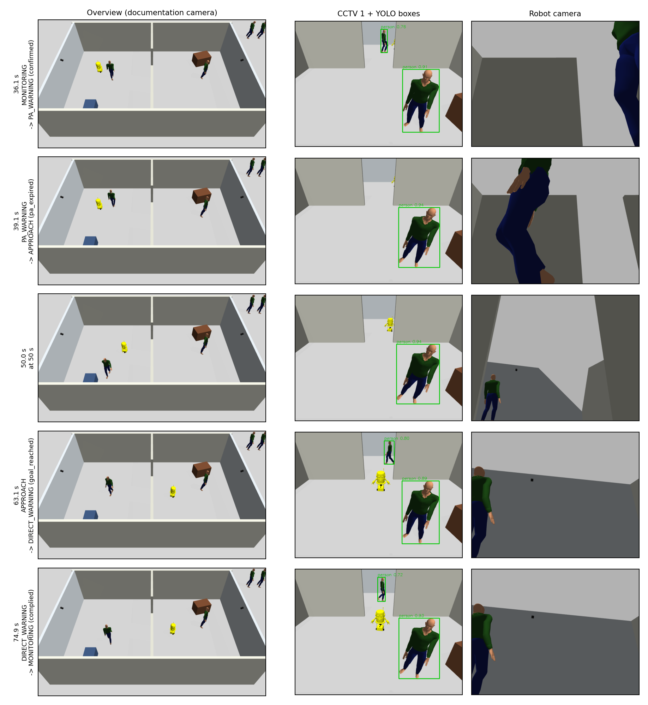

# Pictures of the simulation

Pictures for reporting, taken from **documentation runs**. These are separate from the evaluation runs
and never enter the metrics. To take the pictures, two extra cameras are added to the world and every
camera topic is subscribed to. Both add load: the documentation run below ran at RTF 0.74, against 0.80
for the same seed without them.

## A_seed0: Scenario A (smoking, violator complies after the direct warning), seed 0

| | |
|---|---|
| Run | tag `doc_pictures`, scenario A, seed 0, 2026-11-19, replacement machine ([`../README.md`](../README.md#replacement-machine-2026-11-19-set-up-incidents-and-open-uncertainties)) |
| Code | fingerprint `f7bb8f4bdff9a649` (branch `wsl-progress`; YOLO `torch_threads` = 2) |
| Result | `ok`, outcome **complied** in **S3** at 74.9 s sim, RTF 0.742 ([`A_seed0_run_info.json`](A_seed0_run_info.json), [`A_seed0_overlay.yaml`](A_seed0_overlay.yaml)). The same seed without the documentation cameras: complied S3 at 74.7 s; baseline: 74.8 s. |
| How | [`capture_pictures.py`](../../evaluation/scripts/capture_pictures.py)` --domain 61 --overview --at 20 33 50 68`, started together with `run_batch.py --tag doc_pictures`. One snapshot of every camera at each FSM transition and at 20, 33, 50 and 68 s sim, plus one at the end. |
| Files | [`A_seed0/`](A_seed0/): `<NN>_<sim time>s_<FSM state>__<camera>.png`; [`A_seed0/index.csv`](A_seed0/index.csv) lists each file's sim time, trigger, state, camera and topic. 9 snapshots × 7 cameras. |

Cameras: `cctv1_raw`, `cctv2_raw` (the CCTV images YOLO receives, 640×480); `cctv1_yolo`,
`cctv2_yolo` (the detector's debug view with its boxes); `robot_camera` (the robot's camera);
`overview_top`, `overview_oblique` (**documentation cameras only**, spawned at run start via
`/spawn_entity` as static models `doc_overview_top` and `doc_overview_oblique`, 1 Hz; they are not part of
the evaluated system).

### Storyboard

*Scenario A, seed 0. Rows: confirmation and PA warning (36.1 s), start of the approach (39.1 s), mid-approach
(50.0 s), arrival and direct warning (63.1 s), compliance (74.9 s). Columns: oblique overview (documentation
camera), CCTV 1 with the YOLO boxes, robot camera. Made by
[`make_storyboard.py`](../../evaluation/scripts/make_storyboard.py). [PDF](A_seed0_storyboard.pdf)*

**What the pictures show, and what to state with them:**

1. **The cigarette is not rendered.** YOLO detects only `person` in the CCTV images. In simulation, the
   device and support detections are injected by `scenario_publisher_node` (`mode: world`) and attached to
   the violator's box; they do not appear in any image. A caption that shows a CCTV frame must say so.
2. **A bystander outside the scenario is visible to CCTV 1.** `person_walking`, the looping scripted walker
   of the demo world (`docs/sim_audit.md`), walks in room B. CCTV 1 sees it through the doorway, and YOLO
   detects it as a person (0.72–0.80 in these frames). It is not one of the scenario's people.
3. **The walker passes next to the robot at its base** (robot camera at 36.1 and 39.1 s). Gazebo actors have
   no collision geometry, so nothing stops them from walking into the robot.
4. **The robot does not face the violator during the direct warning.** At 63.1 and 74.9 s, the violator
   is at the left edge of the robot camera's view, partly cut off. The robot stops at the cctv1 camera spot
   (1.8, 0) with the spot's heading (yaw 0), not turned towards the person. This matters for any claim about
   the robot's evidence photos: the incident emailer uses this camera. Seen in one run.
5. Two spare actors stand outside the building, top right in the overview. They are scenario people not used
   in scenario A, parked off-stage as designed.

The top-down figure of the same seed (without documentation cameras) is
[`../machine_change/topdown_A0_wsl_threads2.png`](../machine_change/topdown_A0_wsl_threads2.png).
